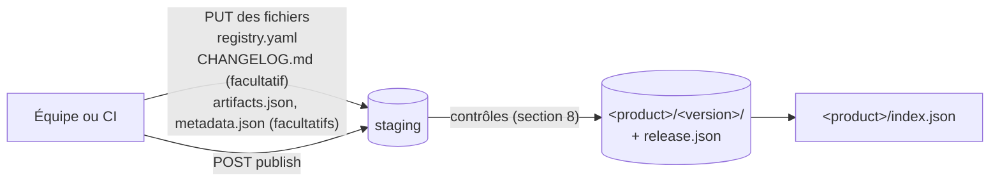

# Le standard `local-registry/v1`

[English](SPEC.md) · Statut : **stable**, version `local-registry/v1`

Ce document est la définition normative des documents et des routes que local-registry utilise pour décrire ce qu'il publie. Il s'adresse à ceux qui écrivent un client, un serveur ou un outil autour de local-registry. Pour *utiliser* local-registry, lisez plutôt la [documentation](website/i18n/fr/docusaurus-plugin-content-docs/current/intro.md) : les guides et les exemples s'y trouvent, pas ici.

Les mots-clés **DOIT**, **NE DOIT PAS**, **DEVRAIT** et **PEUT** s'entendent au sens de la [RFC 2119](https://www.rfc-editor.org/rfc/rfc2119) et de la [RFC 8174](https://www.rfc-editor.org/rfc/rfc8174) lorsque, et seulement lorsque, ils sont écrits en capitales grasses. Les messages d'erreur cités sont informatifs ; les codes de statut sont normatifs. En cas de divergence, la [version anglaise](SPEC.md) fait foi.

## Sommaire

1. [Terminologie](#1-terminologie)
2. [Vue d'ensemble](#2-vue-densemble)
3. [`registry.yaml` : la fiche produit](#3-registryyaml--la-fiche-produit)
4. [`CHANGELOG.md` : les notes de version](#4-changelogmd--les-notes-de-version)
5. [`release.json` : une version](#5-releasejson--une-version)
6. [`index.json` : un produit et ses versions](#6-indexjson--un-produit-et-ses-versions)
7. [Routes](#7-routes)
8. [Règles de publication](#8-règles-de-publication)
9. [Conformité des clients](#9-conformité-des-clients)
10. [Versionnement du standard](#10-versionnement-du-standard)

## 1. Terminologie

| Terme | Définition |
| --- | --- |
| **Produit** | Ce qu'une équipe livre et versionne : un CLI, un lot de migrations, un paquet de politiques. C'est le segment `{product}` de chaque URL. |
| **Version** | Une publication d'un produit, en général son tag git (`v1.4.2`). C'est le segment `{version}` de chaque URL. |
| **Nom valide** | Une chaîne qui correspond à `[A-Za-z0-9._-]+` et qui n'est ni `.` ni `..`. |
| **Staging** | La zone privée où l'on dépose les fichiers d'une version avant sa publication. |
| **Publication** | L'opération qui vérifie une version déposée et la rend visible, entière, en une seule étape. |
| **Artefact** | Un fichier téléchargeable d'une version qui est un livrable à part entière (archive, binaire, paquet, fichier, sources), par opposition au fichier de checksums et aux pièces jointes. |
| **Pièce jointe** | Un SBOM, une signature ou un certificat qui couvre un autre fichier, nommé `<fichier couvert><suffixe>`. |
| **Latest** | La version désignée comme courante pour un produit (section 6). |

Un nom de produit **DOIT** être un nom valide autre que `products`. Un nom de version **DOIT** être un nom valide autre que `latest`, `artifacts.json`, `artifacts.goreleaser.json`, `release.json` et `index.json`. Des noms en minuscules avec `-` **DEVRAIENT** être utilisés. Une version publiée **NE DOIT PAS** changer.

## 2. Vue d'ensemble

| Document | Écrit par | Stocké dans | Rôle |
| --- | --- | --- | --- |
| `registry.yaml` | l'équipe, **obligatoire** | `<product>/<version>/registry.yaml` | Fiche produit, et dépréciation de la version |
| `CHANGELOG.md` | goreleaser ou l'équipe, facultatif | `<product>/<version>/CHANGELOG.md` | Source des notes de version |
| `release.json` | le serveur, à la publication | `<product>/<version>/release.json` | Une version, normalisée, immuable |
| `index.json` | le serveur, à chaque publication | `<product>/index.json` | Le produit et toutes ses versions |

Les chemins sont relatifs à l'arborescence publiée du serveur. Chaque document généré par le serveur porte `"apiVersion": "local-registry/v1"`.

Le standard s'appuie sur ce que produit [goreleaser](https://goreleaser.com) (`artifacts.json`, `metadata.json`, un fichier de checksums) mais ne l'exige pas : `registry.yaml` et les fichiers suffisent, le serveur déduit le reste.



## 3. `registry.yaml` : la fiche produit

L'équipe écrit ce fichier et l'envoie avec chaque version : chaque version garde ainsi la fiche avec laquelle elle a été publiée.

```yaml
apiVersion: local-registry/v1
displayName: SonarBridge
description: Pont entre SonarQube et les outils internes.
license: Apache-2.0
owners:
  - name: Équipe plateforme
    email: platform@corp.example
links:
  - { name: source, url: https://git.corp.example/platform/sonarbridge }
  - { name: docs, url: https://docs.corp.example/sonarbridge }
keywords: [sonar, cli]
labels:
  domain: quality
  cost-center: "4512"
install: |
  curl -fsSL https://registry.example.com/sonarbridge/artifacts/v1.4.2/files/sonarbridge_1.4.2_linux_amd64.tar.gz | tar xz
deprecated: false
```

| Champ | Type | Obligatoire | Contrainte |
| --- | --- | --- | --- |
| `apiVersion` | chaîne | **oui** | exactement `local-registry/v1` |
| `displayName` | chaîne | non | au plus 100 caractères |
| `description` | chaîne | non | au plus 500 caractères |
| `license` | chaîne | non | un [identifiant SPDX](https://spdx.org/licenses/) ou `Proprietary` **DEVRAIT** être utilisé |
| `owners[]` | objet `{name, email}` | non | `name` non vide ; `email`, s'il est présent, contient `@` |
| `links[]` | objet `{name, url}` | non | `name` non vide ; `url` absolue, en `http` ou `https`, avec un hôte |
| `keywords[]` | chaîne | non | au plus 20 ; aucun vide |
| `labels` | table de chaînes | non | au plus 50 entrées ; les nombres et booléens sont lus comme des chaînes |
| `install` | chaîne | non | au plus 10 Kio ; Markdown, affiché tel quel |
| `deprecated` | booléen ou chaîne | non | `false` (défaut), `true`, ou un message comme `replaced by sonarbridge2` ; une chaîne vide vaut `false` |

Un serveur **DOIT** refuser, en `422`, un `registry.yaml` qui :

- dépasse 64 Kio, ou contient plus d'un document YAML ;
- a un `apiVersion` autre que `local-registry/v1` ;
- contient une clé absente du tableau (une faute de frappe ne passe pas inaperçue ; les notes de version ne s'écrivent pas ici) ;
- enfreint une contrainte du tableau.

Le serveur vérifie le fichier à son envoi. [`schema/registry.schema.json`](schema/registry.schema.json) (JSON Schema 2020-12) exprime les mêmes règles : un pipeline peut ainsi vérifier le fichier avant de l'envoyer.

## 4. `CHANGELOG.md` : les notes de version

Les notes d'une version viennent de son `CHANGELOG.md`. Un serveur **DOIT** refuser, en `422`, un `CHANGELOG.md` de plus de 1 Mio ou qui n'est pas en UTF-8 valide. À la publication, il transforme le fichier en `changes` (section 5). Deux formes sont lues, et **PEUVENT** se mêler dans un même fichier.

### 4.1 Keep a Changelog

Chaque élément de liste (`- …` ou `* …`) sous un titre de niveau 3 `Added`, `Changed`, `Deprecated`, `Removed`, `Fixed` ou `Security` (casse indifférente) est une note de ce type, son texte pris tel quel. Ces titres ne sont reconnus qu'en anglais.

Si le fichier a des titres de version, c'est-à-dire des titres de niveau 2 comme `## [1.2.0] - 2026-10-18`, `## v1.2.0` ou `## [Unreleased]`, seule la section de la version publiée est lue, le `v` initial étant ignoré des deux côtés. Une version sans section propre n'a aucune note. Un fichier sans titre de version est lu en entier.

```markdown
## [1.0.0] - 2026-10-18
### Added
- table des commandes
### Security
- plus de mot de passe par défaut
```

### 4.2 Conventional Commits (goreleaser)

Chaque autre élément de liste dont le message est un [Conventional Commit](https://www.conventionalcommits.org/) d'un type connu donne une note. Avant l'analyse, le sha de commit en tête (`9c9d766`, `9c9d766:`) et l'auteur en fin (` (@user)`, ` (Nom <mail>)`, ` by @user in <url>`) sont retirés. Les titres, les lignes `**Full Changelog**` et les autres messages sont ignorés.

| Type de commit | `kind` |
| --- | --- |
| `feat`, `add` | `added` |
| `fix`, `bugfix` | `fixed` |
| `perf`, `refactor`, `change` | `changed` |
| `deprecate`, `deprecated` | `deprecated` |
| `remove`, `removed` | `removed` |
| `sec`, `security`, ou tout type de portée `security` ou `sec` | `security` |
| tout autre type marqué incompatible (`chore!: …`) | `changed` |
| tout autre type (`docs`, `test`, `chore`, `ci`…) | pas une note |

Exemple : `* 9c9d766: feat(api): CSV export (@alice)` donne `{"kind": "added", "description": "CSV export"}`.

Sans `CHANGELOG.md`, `changes` vaut `[]`.

## 5. `release.json` : une version

Le serveur écrit `release.json` à la publication, dans la version déposée : il apparaît avec la version et il est immuable comme tous ses fichiers.

```json
{
  "apiVersion": "local-registry/v1",
  "product": "sonarbridge",
  "displayName": "SonarBridge",
  "version": "v1.4.2",
  "tag": "v1.4.2",
  "previousTag": "v1.4.1",
  "prerelease": false,
  "commit": "9c9d7664ceefa1b2…",
  "builtAt": "2026-10-10T20:01:27+02:00",
  "publishedAt": "2026-10-10T18:05:02Z",
  "publishedBy": "e2186dbdb1bb",
  "deprecated": false,
  "securityUpdates": true,
  "changes": [
    { "kind": "added", "description": "CSV export" },
    { "kind": "security", "description": "bump golang.org/x/net" }
  ],
  "artifacts": [
    {
      "name": "sonarbridge_1.4.2_linux_amd64.tar.gz",
      "kind": "archive",
      "format": "tar.gz",
      "mediaType": "application/gzip",
      "os": "linux",
      "arch": "amd64",
      "variant": "v1",
      "size": 4821337,
      "sha256": "3f1c…",
      "url": "https://registry.example.com/sonarbridge/artifacts/v1.4.2/files/sonarbridge_1.4.2_linux_amd64.tar.gz",
      "sbom": "https://registry.example.com/sonarbridge/artifacts/v1.4.2/files/sonarbridge_1.4.2_linux_amd64.tar.gz.sbom.json",
      "signature": null,
      "certificate": null
    }
  ],
  "checksums": {
    "name": "sonarbridge_1.4.2_checksums.txt",
    "url": "https://registry.example.com/sonarbridge/artifacts/v1.4.2/files/sonarbridge_1.4.2_checksums.txt",
    "signature": null,
    "certificate": null
  }
}
```

Chaque clé **DOIT** être présente. Une valeur inconnue vaut `null`, jamais une clé absente.

### 5.1 Champs

| Champ | Type | Valeur |
| --- | --- | --- |
| `apiVersion` | chaîne | `local-registry/v1` |
| `product`, `version` | chaîne | les segments `{product}` et `{version}` de l'URL de publication |
| `displayName` | chaîne | `displayName` de `registry.yaml`, sinon `project_name` de `metadata.json`, sinon `product` |
| `tag`, `previousTag`, `commit`, `builtAt` | chaîne ou null | `tag`, `previous_tag`, `commit` et `date` de `metadata.json` ; `null` sans lui ou s'ils sont vides |
| `prerelease` | booléen | `version` est une version sémantique avec une partie pré-version (`v1.5.0-rc.1`) |
| `publishedAt` | chaîne | heure de publication, UTC, RFC 3339 |
| `publishedBy` | chaîne | `token_id` du token d'upload : les 12 premiers chiffres hexadécimaux de son sha256. Jamais le token. |
| `deprecated` | booléen ou chaîne | `deprecated` de `registry.yaml` |
| `securityUpdates` | booléen | `true` si une note de `changes` est de type `security` |
| `changes[]` | `{kind, description}` | issu de `CHANGELOG.md` (section 4) ; `kind` vaut `added`, `changed`, `deprecated`, `removed`, `fixed` ou `security` |
| `artifacts[]` | objet | les artefacts de la version (5.2), dans l'ordre d'`artifacts.json`, sinon par nom |
| `checksums` | objet ou null | le fichier de checksums : `{name, url, signature, certificate}` |

Champs d'une entrée de `artifacts[]` :

| Champ | Type | Valeur |
| --- | --- | --- |
| `name` | chaîne | nom du fichier |
| `kind` | chaîne | `archive`, `binary`, `package`, `file` ou `source` (5.2) |
| `format` | chaîne ou null | `extra.Format` d'`artifacts.json`, sinon l'extension sans son point (`tar.gz`, `tar.xz`, `tar.zst` et `tar.bz2` comptent pour une), sinon `null` |
| `mediaType` | chaîne | déduit du nom (5.3) |
| `os`, `arch` | chaîne ou null | `goos` et `goarch` d'`artifacts.json` ; `null` pour un fichier qui ne dépend d'aucune plateforme |
| `variant` | chaîne ou null | le premier non vide parmi `goamd64`, `goarm`, `goarm64`, `go386`, `gomips`, `goppc64`, `goriscv64` |
| `size`, `sha256` | entier, chaîne | calculés par le serveur sur le fichier stocké |
| `url` | chaîne | URL de téléchargement `/{product}/artifacts/{version}/files/{name}`, absolue quand le serveur connaît son URL publique, relative sinon |
| `sbom`, `signature`, `certificate` | chaîne ou null | URL de la pièce jointe qui couvre ce fichier |

### 5.2 Artefacts et pièces jointes

Avec un `artifacts.json`, chaque entrée publiée est classée selon son `type` goreleaser :

| `type` | Résultat |
| --- | --- |
| `Archive` | artefact, kind `archive` |
| `Binary` avec `extra.Format` | artefact, kind `binary` |
| `Linux Package` | artefact, kind `package` |
| `File` | artefact, kind `file` |
| `Source` | artefact, kind `source` |
| `Checksum` | `checksums` |
| `SBOM`, `Signature`, `Certificate` | pièce jointe |
| `Metadata` | non listé (ses valeurs remplissent les champs de la version) |
| `Binary` sans `extra.Format` | ignoré : un résultat de compilation, pas un fichier publié |

Sans `artifacts.json`, chaque fichier stocké autre que `registry.yaml`, `CHANGELOG.md`, `metadata.json` et les fichiers écrits par le serveur est classé selon son nom :

| Nom | Résultat |
| --- | --- |
| le fichier de checksums | `checksums` |
| le nom d'un autre fichier stocké suivi d'un suffixe de pièce jointe | pièce jointe |
| finit par `.tar.gz`, `.tgz`, `.tar.xz`, `.tar.zst`, `.tar.bz2`, `.tar` ou `.zip` | artefact, kind `archive` |
| finit par `.deb`, `.rpm` ou `.apk` | artefact, kind `package` |
| tout autre nom | artefact, kind `file` |

Dans ce cas `os`, `arch` et `variant` valent `null`. Un éditeur qui en a besoin **DOIT** envoyer un `artifacts.json`, qui **PEUT** être écrit à la main (`name`, `path`, `type`, `goos`, `goarch`).

Une pièce jointe nommée `<nom><suffixe>` couvre l'artefact `<nom>`, ou le fichier de checksums quand `<nom>` est le sien :

| Pièce jointe | Suffixes |
| --- | --- |
| `sbom` | `.sbom.json`, `.spdx.json`, `.cdx.json`, `.sbom` |
| `signature` | `.sigstore.json`, `.bundle`, `.sig` |
| `certificate` | `.pem`, `.crt`, `.cert` |

Quand un fichier a deux pièces jointes du même type, la première l'emporte. Une pièce jointe qui ne couvre aucun fichier reste téléchargeable mais n'apparaît dans aucune entrée.

### 5.3 Types de média

Le type de média se déduit de la fin du nom, casse ignorée, premier suffixe trouvé. Tout autre nom donne `application/octet-stream`.

| Suffixe | `mediaType` |
| --- | --- |
| `.tar.gz`, `.tgz`, `.gz` | `application/gzip` |
| `.tar.xz`, `.xz` | `application/x-xz` |
| `.tar.zst`, `.zst` | `application/zstd` |
| `.tar` | `application/x-tar` |
| `.zip` | `application/zip` |
| `.deb` | `application/vnd.debian.binary-package` |
| `.rpm` | `application/x-rpm` |
| `.exe` | `application/vnd.microsoft.portable-executable` |
| `.msi` | `application/x-msi` |
| `.dmg` | `application/x-apple-diskimage` |
| `.pdf` | `application/pdf` |
| `.sql` | `application/sql` |
| `.yaml`, `.yml` | `application/yaml` |
| `.json` | `application/json` |
| `.sh` | `application/x-sh` |
| `.md` | `text/markdown` |
| `.txt` | `text/plain` |

## 6. `index.json` : un produit et ses versions

```json
{
  "apiVersion": "local-registry/v1",
  "product": "sonarbridge",
  "displayName": "SonarBridge",
  "description": "Pont entre SonarQube et les outils internes.",
  "license": "Apache-2.0",
  "owners": [{ "name": "Équipe plateforme", "email": "platform@corp.example" }],
  "links": [{ "name": "source", "url": "https://git.corp.example/platform/sonarbridge" }],
  "keywords": ["sonar", "cli"],
  "labels": { "domain": "quality" },
  "install": "…",
  "latest": "v1.4.2",
  "updatedAt": "2026-10-12T08:00:00Z",
  "versions": [
    { "version": "v1.5.0-rc.1", "tag": "v1.5.0-rc.1", "publishedAt": "2026-10-12T08:00:00Z", "prerelease": true, "securityUpdates": false, "deprecated": false },
    { "version": "v1.4.2", "tag": "v1.4.2", "publishedAt": "2026-10-10T18:05:02Z", "prerelease": false, "securityUpdates": true, "deprecated": false }
  ]
}
```

- **`versions[]`** liste toutes les versions du produit qui ont un `release.json`, avec les champs de même nom de ce document. Les versions sémantiques viennent d'abord, de la plus haute à la plus basse selon la précédence semver ; les autres noms suivent, du `publishedAt` le plus récent au plus ancien.
- **`latest`** est la dernière version, ou `null`. Une publication avec `latest=true` copie le `release.json` de la version dans `<product>/release.json` ; la dernière version est la `version` que nomme cette copie, à condition que `<product>/<version>/release.json` existe. Un exploitant la change en y copiant le `release.json` d'une autre version.
- **La fiche** (`displayName`, `description`, `license`, `owners`, `links`, `keywords`, `labels`, `install`) vient du `registry.yaml` de la dernière version, sinon de la version publiée en dernier. Les valeurs absentes valent `""` pour les chaînes, `[]` ou `{}` pour les listes et les tables. `displayName` est celui du `release.json` de cette version.
- **`updatedAt`** est le `publishedAt` le plus récent.

Le serveur réécrit `index.json` après chaque publication du produit. Un serveur **PEUT** construire l'index à partir de son stockage à chaque requête au lieu de relire le fichier ; ce serveur le fait, si bien qu'un latest changé à la main se voit aussitôt.

## 7. Routes

Ces routes sont en lecture seule et ne demandent aucun token. Elles répondent à `GET` et `HEAD`. Une erreur est un objet JSON `{"error": "<message>"}`.

| Route | Réponse | Erreurs |
| --- | --- | --- |
| `GET /products` | tableau de `{product, displayName, description, latest, updatedAt}`, par nom de produit ; `[]` s'il n'y en a aucun | aucune |
| `GET /{product}/index` | l'index (section 6) | `404` si aucune version du produit n'a de `release.json` |
| `GET /{product}/releases/{version}` | le `release.json` de la version ; `{version}` **PEUT** valoir `latest` | `404` s'il n'existe pas |
| `GET /{product}/artifacts/{version}/files/{name}` | un fichier d'une version publiée | `404` s'il n'existe pas |

Les autres routes du serveur (upload, `artifacts.json`, routes historiques) ne font pas partie du standard ; la [référence de l'API HTTP](website/i18n/fr/docusaurus-plugin-content-docs/current/reference/api/index.md) les décrit.

## 8. Règles de publication

Un serveur conforme ne publie une version que si toutes les règles suivantes sont respectées, et répond sinon avec le statut indiqué. Rien n'est publié en cas de refus ; les fichiers déposés sont conservés.

| Règle | Statut en cas de manquement |
| --- | --- |
| Les noms de produit et de version sont valides (section 1). | `400` |
| Aucun fichier envoyé ne s'appelle `release.json`, `index.json` ou `artifacts.goreleaser.json`, et `artifacts.json` n'en liste aucun. | `400` à l'envoi, `422` dans `artifacts.json` |
| `registry.yaml` est envoyé et valide (section 3). | `422` |
| `CHANGELOG.md`, s'il est envoyé, est valide (section 4). | `422` |
| Au plus un fichier dont le nom finit par `checksums.txt` (casse indifférente) est envoyé. | `422` |
| Avec un fichier de checksums : chaque fichier stocké y figure avec son sha256, sauf `registry.yaml`, `CHANGELOG.md`, `metadata.json`, les fichiers écrits par le serveur et les signatures (`*.sig`, `*.pem`, `*.sigstore.json`). | `422` |
| Avec `metadata.json` : il contient `tag` ou `version`, et `{version}` vaut `tag`, `version` ou `v` suivi de `version`. | `422` |
| Avec `artifacts.json` : chaque fichier qu'il publie est stocké, avec le sha256 que donne son `extra.Checksum` ; chaque fichier stocké sauf `registry.yaml`, `CHANGELOG.md` et `metadata.json` est l'une de ses entrées. | `422` |
| La version a au moins un artefact (section 5.2). | `422` |
| La version n'est pas déjà publiée. | `409` |

Sans fichier de checksums, le serveur **DOIT** écrire `checksums.txt` au même format : une ligne `<sha256>  <nom>` par fichier qui en demande une, triées par nom. La version apparaît alors entière, en une seule étape, avec son `release.json`, et `index.json` est réécrit.

## 9. Conformité des clients

Un client de ce standard :

- **DOIT** ignorer les champs qu'il ne connaît pas, dans tous les documents (section 10) ;
- **DOIT** traiter `null` comme « inconnu », sans s'attendre à une clé absente ;
- **DEVRAIT** lire `release.json` et `index.json` plutôt que deviner des noms de fichiers ou lire `artifacts.json`, qui n'existe que pour les versions publiées avec ;
- **DEVRAIT** vérifier chaque fichier téléchargé avec le `sha256` de son entrée `artifacts[]` ;
- **NE DEVRAIT PAS** dépendre de l'ordre de `artifacts[]`, `changes[]` ou `labels`.

## 10. Versionnement du standard

`apiVersion` ne change (`local-registry/v2`) que pour une évolution incompatible : un champ supprimé ou renommé, ou le type ou le sens d'un champ modifié. Ajouter un champ, un `kind`, un type de média, un suffixe ou un type de commit reste compatible et garde `local-registry/v1`.
