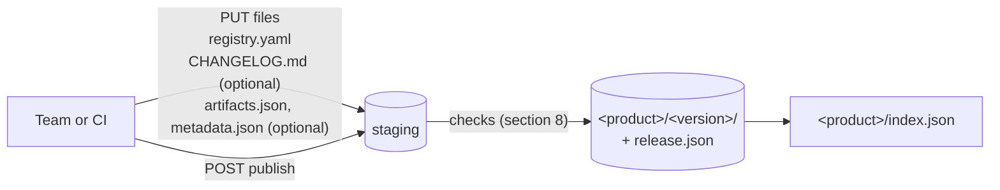

# The `local-registry/v1` standard

[Français](SPEC.fr.md) · Status: **stable**, version `local-registry/v1`

This document is the normative definition of the documents and routes local-registry uses to describe what it publishes. It is written for people who build a client, a server or a tool around local-registry. To *use* local-registry, read the [documentation](website/docs/intro.md) instead: guides and examples live there, not here.

The key words **MUST**, **MUST NOT**, **SHOULD** and **MAY** are to be read as described in [RFC 2119](https://www.rfc-editor.org/rfc/rfc2119) and [RFC 8174](https://www.rfc-editor.org/rfc/rfc8174) when, and only when, they appear in bold capitals. Error messages quoted in this document are informative; status codes are normative.

## Contents

1. [Terminology](#1-terminology)
2. [Overview](#2-overview)
3. [`registry.yaml`: the product card](#3-registryyaml-the-product-card)
4. [`CHANGELOG.md`: the release notes](#4-changelogmd-the-release-notes)
5. [`release.json`: one version](#5-releasejson-one-version)
6. [`index.json`: a product and its versions](#6-indexjson-a-product-and-its-versions)
7. [Routes](#7-routes)
8. [Publication rules](#8-publication-rules)
9. [Client conformance](#9-client-conformance)
10. [Versioning of the standard](#10-versioning-of-the-standard)

## 1. Terminology

| Term           | Definition                                                                                                                                                   |
|----------------|--------------------------------------------------------------------------------------------------------------------------------------------------------------|
| **Product**    | What a team delivers and versions: a CLI, a set of migrations, a policy bundle. It is the `{product}` segment of every URL.                                  |
| **Version**    | One published release of a product, usually its git tag (`v1.4.2`). It is the `{version}` segment of every URL.                                              |
| **Valid name** | A string that matches `[A-Za-z0-9._-]+` and is neither `.` nor `..`.                                                                                         |
| **Staging**    | The private area where the files of a version are uploaded before publication.                                                                               |
| **Publish**    | The operation that checks a staged version and makes it visible, whole, in one step.                                                                         |
| **Artifact**   | A downloadable file of a version that is a deliverable of its own (archive, binary, package, file, source), as opposed to a checksums file or an attachment. |
| **Attachment** | An SBOM, signature or certificate that covers another file, named `<covered file><suffix>`.                                                                  |
| **Latest**     | The version of a product designated as current (section 6).                                                                                                  |

A product name **MUST** be a valid name other than `products`. A version name **MUST** be a valid name other than `latest`, `artifacts.json`, `artifacts.goreleaser.json`, `release.json` and `index.json`. Lowercase names with `-` **SHOULD** be used. A published version **MUST NOT** change.

## 2. Overview

| Document | Written by | Stored at | Role |
| --- | --- | --- | --- |
| `registry.yaml` | the team, **required** | `<product>/<version>/registry.yaml` | Product card, and deprecation of the version |
| `CHANGELOG.md` | goreleaser or the team, optional | `<product>/<version>/CHANGELOG.md` | Source of the release notes |
| `release.json` | the server, at publish | `<product>/<version>/release.json` | One version, normalised, immutable |
| `index.json` | the server, at each publish | `<product>/index.json` | The product and all its versions |

Paths are relative to the server's published tree. Every document the server generates carries `"apiVersion": "local-registry/v1"`.

The standard builds on what [goreleaser](https://goreleaser.com) produces (`artifacts.json`, `metadata.json`, a checksums file) but does not require it: `registry.yaml` and the files are enough, and the server infers the rest.



## 3. `registry.yaml`: the product card

The team writes this file and uploads it with each version, so each version keeps the card it was published with.

```yaml
apiVersion: local-registry/v1
displayName: SonarBridge
description: Bridge between SonarQube and internal tools.
license: Apache-2.0
owners:
  - name: Platform team
    email: platform@corp.example
links:
  - { name: source, url: https://git.corp.example/platform/sonarbridge }
  - { name: docs, url: https://docs.corp.example/sonarbridge }
keywords: [sonar, cli]
labels:
  domain: quality
  cost-center: "4512"
install: |
  curl -fsSL https://registry.example.com/sonarbridge/artifacts/v1.4.2/files/sonarbridge_1.4.2_linux_amd64.tar.gz | tar xz
deprecated: false
```

| Field | Type | Required | Constraint |
| --- | --- | --- | --- |
| `apiVersion` | string | **yes** | exactly `local-registry/v1` |
| `displayName` | string | no | at most 100 characters |
| `description` | string | no | at most 500 characters |
| `license` | string | no | an [SPDX identifier](https://spdx.org/licenses/) or `Proprietary` **SHOULD** be used |
| `owners[]` | object `{name, email}` | no | `name` not empty; `email`, when present, contains `@` |
| `links[]` | object `{name, url}` | no | `name` not empty; `url` absolute, scheme `http` or `https`, with a host |
| `keywords[]` | string | no | at most 20; none blank |
| `labels` | map of string | no | at most 50 entries; number and boolean values are read as strings |
| `install` | string | no | at most 10 KiB; Markdown, shown as is |
| `deprecated` | boolean or string | no | `false` (default), `true`, or a message such as `replaced by sonarbridge2`; an empty string means `false` |

A server **MUST** refuse, with `422`, a `registry.yaml` that:

- is larger than 64 KiB, or holds more than one YAML document;
- has an `apiVersion` other than `local-registry/v1`;
- has a key not listed above (a typo cannot pass unnoticed; release notes are not written here);
- breaks a constraint of the table.

The server checks the file when it is uploaded. [`schema/registry.schema.json`](schema/registry.schema.json) (JSON Schema 2020-12) expresses the same rules, so a pipeline can check the file before sending it.

## 4. `CHANGELOG.md`: the release notes

The release notes of a version come from its `CHANGELOG.md`. A server **MUST** refuse, with `422`, a `CHANGELOG.md` larger than 1 MiB or not valid UTF-8. At publish, it turns the file into `changes` (section 5). Two forms are read, and **MAY** be mixed in one file.

### 4.1 Keep a Changelog

Each list item (`- …` or `* …`) under a level 3 heading `Added`, `Changed`, `Deprecated`, `Removed`, `Fixed` or `Security` (any case) is one note of that kind, its text taken as is. The headings are recognised in English only.

If the file has version headings, that is level 2 headings such as `## [1.2.0] - 2026-10-18`, `## v1.2.0` or `## [Unreleased]`, only the section of the published version is read, the leading `v` being ignored on both sides. A version without its own section has no notes. A file without version headings is read whole.

```markdown
## [1.0.0] - 2026-10-18
### Added
- orders table
### Security
- no default password
```

### 4.2 Conventional Commits (goreleaser)

Each other list item whose message is a [Conventional Commit](https://www.conventionalcommits.org/) of a known type is one note. Before parsing, a leading commit sha (`9c9d766`, `9c9d766:`) and a trailing author (` (@user)`, ` (Name <mail>)`, ` by @user in <url>`) are removed. Headings, `**Full Changelog**` lines and other messages are ignored.

| Commit type | `kind` |
| --- | --- |
| `feat`, `add` | `added` |
| `fix`, `bugfix` | `fixed` |
| `perf`, `refactor`, `change` | `changed` |
| `deprecate`, `deprecated` | `deprecated` |
| `remove`, `removed` | `removed` |
| `sec`, `security`, or any type with scope `security` or `sec` | `security` |
| any other type marked breaking (`chore!: …`) | `changed` |
| any other type (`docs`, `test`, `chore`, `ci`…) | not a note |

Example: `* 9c9d766: feat(api): CSV export (@alice)` gives `{"kind": "added", "description": "CSV export"}`.

Without `CHANGELOG.md`, `changes` is `[]`.

## 5. `release.json`: one version

The server writes `release.json` at publish, inside the staged version: it appears with the version and is immutable like every other file.

```json
{
  "apiVersion": "local-registry/v1",
  "product": "sonarbridge",
  "displayName": "SonarBridge",
  "version": "v1.4.2",
  "tag": "v1.4.2",
  "previousTag": "v1.4.1",
  "prerelease": false,
  "commit": "9c9d7664ceefa1b2…",
  "builtAt": "2026-10-10T20:01:27+02:00",
  "publishedAt": "2026-10-10T18:05:02Z",
  "publishedBy": "e2186dbdb1bb",
  "deprecated": false,
  "securityUpdates": true,
  "changes": [
    { "kind": "added", "description": "CSV export" },
    { "kind": "security", "description": "bump golang.org/x/net" }
  ],
  "artifacts": [
    {
      "name": "sonarbridge_1.4.2_linux_amd64.tar.gz",
      "kind": "archive",
      "format": "tar.gz",
      "mediaType": "application/gzip",
      "os": "linux",
      "arch": "amd64",
      "variant": "v1",
      "size": 4821337,
      "sha256": "3f1c…",
      "url": "https://registry.example.com/sonarbridge/artifacts/v1.4.2/files/sonarbridge_1.4.2_linux_amd64.tar.gz",
      "sbom": "https://registry.example.com/sonarbridge/artifacts/v1.4.2/files/sonarbridge_1.4.2_linux_amd64.tar.gz.sbom.json",
      "signature": null,
      "certificate": null
    }
  ],
  "checksums": {
    "name": "sonarbridge_1.4.2_checksums.txt",
    "url": "https://registry.example.com/sonarbridge/artifacts/v1.4.2/files/sonarbridge_1.4.2_checksums.txt",
    "signature": null,
    "certificate": null
  }
}
```

Every key **MUST** be present. A value that is unknown is `null`, never a missing key.

### 5.1 Fields

| Field | Type | Value |
| --- | --- | --- |
| `apiVersion` | string | `local-registry/v1` |
| `product`, `version` | string | the `{product}` and `{version}` segments of the publish URL |
| `displayName` | string | `displayName` of `registry.yaml`, else `project_name` of `metadata.json`, else `product` |
| `tag`, `previousTag`, `commit`, `builtAt` | string or null | `tag`, `previous_tag`, `commit` and `date` of `metadata.json`; `null` without it or when empty |
| `prerelease` | boolean | `version` is a semantic version with a pre-release part (`v1.5.0-rc.1`) |
| `publishedAt` | string | time of publication, UTC, RFC 3339 |
| `publishedBy` | string | `token_id` of the upload token: the first 12 hex digits of its sha256. Never the token. |
| `deprecated` | boolean or string | `deprecated` of `registry.yaml` |
| `securityUpdates` | boolean | `true` when a note of `changes` has kind `security` |
| `changes[]` | `{kind, description}` | from `CHANGELOG.md` (section 4); `kind` is `added`, `changed`, `deprecated`, `removed`, `fixed` or `security` |
| `artifacts[]` | object | the artifacts of the version (5.2), in the order of `artifacts.json`, else by name |
| `checksums` | object or null | the checksums file: `{name, url, signature, certificate}` |

Fields of an entry of `artifacts[]`:

| Field | Type | Value |
| --- | --- | --- |
| `name` | string | file name |
| `kind` | string | `archive`, `binary`, `package`, `file` or `source` (5.2) |
| `format` | string or null | `extra.Format` of `artifacts.json`, else the extension without its dot (`tar.gz`, `tar.xz`, `tar.zst` and `tar.bz2` count as one), else `null` |
| `mediaType` | string | from the name (5.3) |
| `os`, `arch` | string or null | `goos` and `goarch` of `artifacts.json`; `null` for a file that does not depend on a platform |
| `variant` | string or null | the first non-empty of `goamd64`, `goarm`, `goarm64`, `go386`, `gomips`, `goppc64`, `goriscv64` |
| `size`, `sha256` | integer, string | computed by the server from the stored file |
| `url` | string | download URL `/{product}/artifacts/{version}/files/{name}`, absolute when the server knows its public URL, else relative |
| `sbom`, `signature`, `certificate` | string or null | URL of the attachment that covers this file |

### 5.2 Artifacts and attachments

With an `artifacts.json`, each published entry is classified by its goreleaser `type`:

| `type` | Result |
| --- | --- |
| `Archive` | artifact, kind `archive` |
| `Binary` with `extra.Format` | artifact, kind `binary` |
| `Linux Package` | artifact, kind `package` |
| `File` | artifact, kind `file` |
| `Source` | artifact, kind `source` |
| `Checksum` | `checksums` |
| `SBOM`, `Signature`, `Certificate` | attachment |
| `Metadata` | not listed (its values fill the version's fields) |
| `Binary` without `extra.Format` | ignored: a build output, not a published file |

Without `artifacts.json`, each stored file other than `registry.yaml`, `CHANGELOG.md`, `metadata.json` and the files the server writes is classified by its name:

| Name | Result |
| --- | --- |
| the checksums file | `checksums` |
| another stored file's name followed by an attachment suffix | attachment |
| ends with `.tar.gz`, `.tgz`, `.tar.xz`, `.tar.zst`, `.tar.bz2`, `.tar` or `.zip` | artifact, kind `archive` |
| ends with `.deb`, `.rpm` or `.apk` | artifact, kind `package` |
| anything else | artifact, kind `file` |

In that case `os`, `arch` and `variant` are `null`. A publisher that needs them **MUST** upload an `artifacts.json`, which **MAY** be written by hand (`name`, `path`, `type`, `goos`, `goarch`).

An attachment named `<name><suffix>` covers the artifact `<name>`, or the checksums file when `<name>` is its name:

| Attachment | Suffixes |
| --- | --- |
| `sbom` | `.sbom.json`, `.spdx.json`, `.cdx.json`, `.sbom` |
| `signature` | `.sigstore.json`, `.bundle`, `.sig` |
| `certificate` | `.pem`, `.crt`, `.cert` |

When a file has two attachments of the same kind, the first one wins. An attachment that covers no file stays downloadable but appears in no entry.

### 5.3 Media types

The media type comes from the end of the name, case ignored, first match wins. Anything else is `application/octet-stream`.

| Suffix | `mediaType` |
| --- | --- |
| `.tar.gz`, `.tgz`, `.gz` | `application/gzip` |
| `.tar.xz`, `.xz` | `application/x-xz` |
| `.tar.zst`, `.zst` | `application/zstd` |
| `.tar` | `application/x-tar` |
| `.zip` | `application/zip` |
| `.deb` | `application/vnd.debian.binary-package` |
| `.rpm` | `application/x-rpm` |
| `.exe` | `application/vnd.microsoft.portable-executable` |
| `.msi` | `application/x-msi` |
| `.dmg` | `application/x-apple-diskimage` |
| `.pdf` | `application/pdf` |
| `.sql` | `application/sql` |
| `.yaml`, `.yml` | `application/yaml` |
| `.json` | `application/json` |
| `.sh` | `application/x-sh` |
| `.md` | `text/markdown` |
| `.txt` | `text/plain` |

## 6. `index.json`: a product and its versions

```json
{
  "apiVersion": "local-registry/v1",
  "product": "sonarbridge",
  "displayName": "SonarBridge",
  "description": "Bridge between SonarQube and internal tools.",
  "license": "Apache-2.0",
  "owners": [{ "name": "Platform team", "email": "platform@corp.example" }],
  "links": [{ "name": "source", "url": "https://git.corp.example/platform/sonarbridge" }],
  "keywords": ["sonar", "cli"],
  "labels": { "domain": "quality" },
  "install": "…",
  "latest": "v1.4.2",
  "updatedAt": "2026-10-12T08:00:00Z",
  "versions": [
    { "version": "v1.5.0-rc.1", "tag": "v1.5.0-rc.1", "publishedAt": "2026-10-12T08:00:00Z", "prerelease": true, "securityUpdates": false, "deprecated": false },
    { "version": "v1.4.2", "tag": "v1.4.2", "publishedAt": "2026-10-10T18:05:02Z", "prerelease": false, "securityUpdates": true, "deprecated": false }
  ]
}
```

- **`versions[]`** lists every version of the product that has a `release.json`, with the fields of that document of the same name. Semantic versions come first, highest first by semver precedence; other names follow, most recent `publishedAt` first.
- **`latest`** is the latest version, or `null`. Publishing with `latest=true` copies the version's `release.json` to `<product>/release.json`; the latest version is the `version` that copy names, provided `<product>/<version>/release.json` exists. An operator changes it by copying another version's `release.json` there.
- **The card** (`displayName`, `description`, `license`, `owners`, `links`, `keywords`, `labels`, `install`) comes from the `registry.yaml` of the latest version, else of the version published last. Missing values are `""` for strings and `[]` or `{}` for lists and maps. `displayName` is the one of that version's `release.json`.
- **`updatedAt`** is the most recent `publishedAt`.

The server rewrites `index.json` after each publish of the product. A server **MAY** build the index from its storage at each request instead of reading the file; this server does, so a latest changed by hand shows at once.

## 7. Routes

These routes are read-only and need no token. They answer `GET` and `HEAD`. An error is a JSON object `{"error": "<message>"}`.

| Route | Answer | Errors |
| --- | --- | --- |
| `GET /products` | array of `{product, displayName, description, latest, updatedAt}`, by product name; `[]` when there is none | none |
| `GET /{product}/index` | the index (section 6) | `404` when no version of the product has a `release.json` |
| `GET /{product}/releases/{version}` | the `release.json` of the version; `{version}` **MAY** be `latest` | `404` when there is none |
| `GET /{product}/artifacts/{version}/files/{name}` | a file of a published version | `404` when there is none |

The other routes of the server (upload, `artifacts.json`, legacy routes) are not part of the standard; the [HTTP API reference](website/docs/reference/api/index.md) describes them.

## 8. Publication rules

A conforming server publishes a version only when all the following hold, and answers with the given status otherwise. Nothing is published on a refusal; the staged files are kept.

| Rule | Status on violation |
| --- | --- |
| The product and version names are valid (section 1). | `400` |
| No uploaded file is named `release.json`, `index.json` or `artifacts.goreleaser.json`, and `artifacts.json` lists none of them. | `400` on upload, `422` in `artifacts.json` |
| `registry.yaml` is uploaded and valid (section 3). | `422` |
| `CHANGELOG.md`, when uploaded, is valid (section 4). | `422` |
| At most one file whose name ends with `checksums.txt` (any case) is uploaded. | `422` |
| With a checksums file: every stored file is listed in it with its sha256, except `registry.yaml`, `CHANGELOG.md`, `metadata.json`, the files the server writes, and signatures (`*.sig`, `*.pem`, `*.sigstore.json`). | `422` |
| With `metadata.json`: it holds `tag` or `version`, and `{version}` equals `tag`, `version` or `v` followed by `version`. | `422` |
| With `artifacts.json`: every file it publishes is stored, with the sha256 its `extra.Checksum` gives; every stored file except `registry.yaml`, `CHANGELOG.md` and `metadata.json` is one of its entries. | `422` |
| The version has at least one artifact (section 5.2). | `422` |
| The version is not already published. | `409` |

Without a checksums file, the server **MUST** write `checksums.txt` in the same format: one `<sha256>  <name>` line per file that would need one, sorted by name. The version then appears whole, in one step, with its `release.json`, and `index.json` is rewritten.

## 9. Client conformance

A client of this standard:

- **MUST** ignore fields it does not know, in every document (section 10).
- **MUST** treat `null` as "unknown" and not expect a key to be missing.
- **SHOULD** read `release.json` and `index.json` rather than guess file names or read `artifacts.json`, which only exists for versions published with one.
- **SHOULD** check each downloaded file against the `sha256` of its `artifacts[]` entry.
- **SHOULD NOT** rely on the order of `artifacts[]`, `changes[]` or `labels`.

## 10. Versioning of the standard

`apiVersion` changes (`local-registry/v2`) only for an incompatible change: a field removed or renamed, or the type or meaning of a field changed. Adding a field, a `kind`, a media type, a suffix or a commit type is compatible and keeps `local-registry/v1`.
