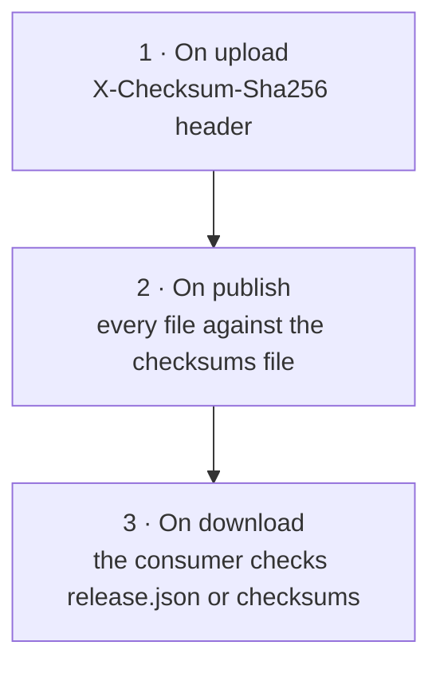

A registry is only useful if you can trust what you download. local-registry checks every file before it publishes it, records its sha256, and hands consumers everything they need to verify it themselves. This page explains the checks, and what remains your responsibility.

## Three layers of checks



**1. On upload.** Each `PUT` may carry the sha256 the publisher computed, in `X-Checksum-Sha256`. The server hashes what it receives and refuses a mismatch (`422 sha256 mismatch`) before the file enters staging. `upload.sh` always sends it when it knows it: for every file of a directory, and for goreleaser files whose entry records one.

**2. On publish.** The server hashes every staged file again and compares the whole version with the checksums file:

- If you uploaded a checksums file (`*checksums.txt`, goreleaser's for instance), every file must be listed in it with the same sha256. A missing or different file refuses the publication.
- If you uploaded none, the server writes `checksums.txt` itself, in the same `<sha256>  <name>` format, from the files it just verified.

Either way, a published version always has a checksums file that matches its files.

**3. On download.** The consumer compares what it downloaded with the sha256 listed in `release.json`, or in the checksums file:

```sh
curl -fsSLO https://registry.example.com/sonarbridge/artifacts/v1.4.2/files/sonarbridge_1.4.2_linux_amd64.tar.gz
curl -fsSL  https://registry.example.com/sonarbridge/artifacts/v1.4.2/files/sonarbridge_1.4.2_checksums.txt |
  sha256sum --check --ignore-missing
```

See [Consume releases](../guides/consume-releases.md) for complete client scripts.

## Files without a checksum line

A few files are not listed in the checksums file, by design: the product card (`registry.yaml`), the release notes (`CHANGELOG.md`), goreleaser's `metadata.json`, the documents the server writes, and signatures (`*.sig`, `*.pem`, `*.sigstore.json`), which sign the checksums file itself. Their sha256 is still recorded in the [audit log](../operations/audit-log.md) at publication.

## Signatures and SBOMs

When you publish signatures, certificates or SBOMs (goreleaser `signs:` and `sboms:`), the server attaches each one to the file it covers, by name: `<file>.sig`, `<file>.pem`, `<file>.sbom.json` and similar. `release.json` then gives, for each file, the URLs of its `sbom`, `signature` and `certificate`, and the same for the checksums file.

> [!IMPORTANT]
> The server links signatures; it does not verify them. Verifying a signature (with cosign or gpg) against your trust policy is the consumer's job. Signing the checksums file is the most efficient way: one signature covers every file.

## What the registry does not protect against

Be explicit about the limits:

| Threat | Covered? |
| --- | --- |
| A file corrupted in transit to the registry, or a wrong file uploaded | **Yes**, by the upload and publish checks |
| A published file changed through the API | **Yes**: published versions are immutable |
| Someone with write access to the storage directory changing a file | **No**: protect the directory and back it up. See [Storage and backup](../operations/storage-and-backup.md) |
| A file tampered with on the network to the consumer | **Only with HTTPS**, or with signature verification. See [Security](../operations/security.md) |
| A malicious build published with a valid token | **No**: protect the token, sign your releases |

## Related

- [Staging and publish](./staging-and-publish.md)
- [Upload rules](../reference/upload-rules.md)
