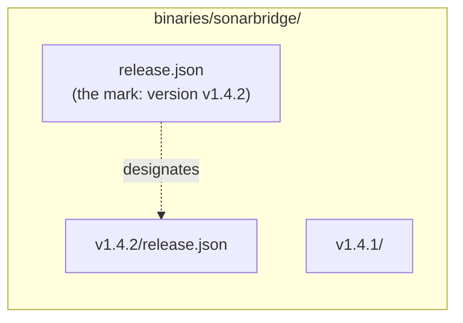

Each product can have one **latest version**: the one clients get when they ask for `latest` instead of a version number. This page explains how it is designated and what that means for publishers and consumers.

## Latest is a decision, not a calculation

The registry never computes latest from version numbers. A version becomes latest only when its publisher says so:

```sh
scripts/upload.sh --latest sonarbridge dist/artifacts.json
# or, by hand: POST /sonarbridge/artifacts/v1.4.2/publish?latest=true
```

This is deliberate. The highest number is not always the one to deploy:

- a `v1.5.0-rc.1` pre-release must not reach production by accident;
- a hotfix `v1.4.3` published after `v1.5.0` must not take its place;
- you may want to publish a version, test it, and promote it later.

Publishing without `--latest` leaves the current latest untouched.

## How the server records it

With `latest=true`, right after the version is published, the server copies its `release.json` to the product directory:



That copy is the **mark**. The latest version is the `version` it names, provided that version is published and has its own `release.json`. Otherwise the product has no latest version.

The server also copies the version's `artifacts.json` next to the mark, for goreleaser clients that read it directly. When the new latest version has no `artifacts.json`, the old copy is removed, so the two never disagree.

The mark is written to a temporary file and renamed into place: readers see the old latest or the new one, never a mix.

## How clients resolve it

These routes accept `latest` where a version is expected:

| Route | Returns |
| --- | --- |
| `GET /{product}/releases/latest` | The `release.json` of the latest version |
| `GET /{product}/index` | The `latest` field names it (`null` when there is none) |
| `GET /products` | The `latest` of each product |
| `GET /{product}/artifacts` | The `artifacts.json` of the latest version, when it has one |
| `POST /releases/{product}/latest` | The files of the latest version and their URLs |

> [!IMPORTANT]
> File downloads do not accept `latest`: `/{product}/artifacts/latest/files/{name}` answers `404`. Resolve latest first through `release.json`, then download the URLs it lists. A download URL therefore always names an exact, immutable version.

```sh
url=$(curl -fsS https://registry.example.com/sonarbridge/releases/latest |
  jq -r '.artifacts[] | select(.os == "linux" and .arch == "amd64") | .url')
curl -fsSLO "https://registry.example.com$url"   # relative URL; absolute when the server sets --public-url
```

When the product has no latest version, these routes answer `404` (and the index says `"latest": null`).

## Changing latest afterwards

To promote a version you published without `--latest`, or to roll back to an older one, copy that version's `release.json` over the mark. There is no API for it yet. See [Change the latest version](../guides/change-latest.md).

> [!NOTE]
> Versions published before `release.json` existed cannot be latest: they have nothing to copy.

## Related

- [Products and versions](./products-and-versions.md)
- [Consume releases](../guides/consume-releases.md)
