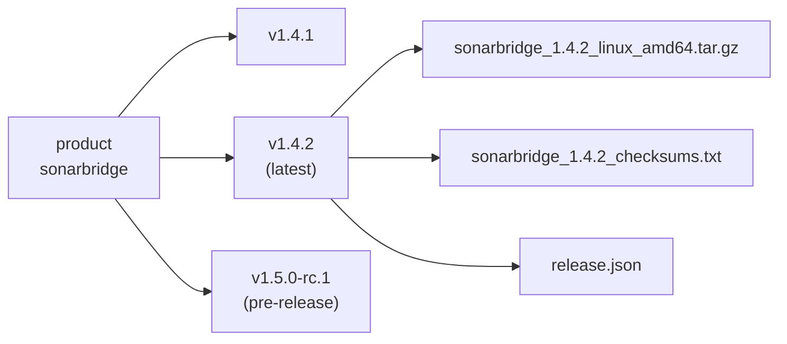

Everything on the registry belongs to a **product**, and every product is a series of **versions**. Understanding these two notions is enough to read any URL of the API.

## Product

A product is what a team delivers and versions: a CLI tool (`sonarbridge`), an agent (`billing-agent`), database migrations (`billing-db-migrations`), a policy bundle (`security-policies`).

- You do not declare a product in advance. It exists as soon as its first version is published.
- Its name is the first segment of every URL: `/sonarbridge/…`.
- It is described by a **product card**, the `registry.yaml` uploaded with each version. See [The local-registry/v1 standard](./standard-v1.md).

## Version

A version is one published release of a product, usually named after its git tag: `v1.4.2`.



A version is **immutable**. Once published, you cannot add, replace or remove a file through the API: uploading to it answers `409 Conflict`. To ship a fix, publish a new version.

> [!NOTE]
> Immutability is what makes a version trustworthy. A deployment that pinned `v1.4.2` last month gets exactly the same bytes today.

### Pre-releases

A version whose name is a semver pre-release (`v1.5.0-rc.1`, `2.0.0-beta`) is flagged `prerelease: true` in its description. The registry never treats it differently otherwise: you decide whether it becomes the [latest version](./latest.md).

### Deprecation

A product card can mark the version it ships with as deprecated, with `deprecated: true` or a message such as `"replaced by sonarbridge2"`. The flag is per version: it shows in that version's `release.json` and in its entry of the product index.

## Names

Product, version and file names follow the same rule, chosen to be safe in URLs and on any file system:

| Rule | |
| --- | --- |
| Characters | `A–Z a–z 0–9 . _ -` only |
| Forbidden | `.` and `..` |
| Reserved product name | `products` |
| Version names you cannot publish | `latest`, `artifacts.json`, `artifacts.goreleaser.json`, `release.json`, `index.json` |

A name outside these rules answers `404` on read routes and `400` on upload routes. On read routes, `latest` is accepted and means the [latest version](./latest.md).

**Recommended:** lowercase products with dashes (`billing-db-migrations`), versions that are semver tags with a `v` (`v1.4.2`). The index sorts semver versions by precedence, newest first; other names come after, most recently published first.

## Reading a URL

Every route is built from these names:

```
https://registry.example.com/sonarbridge/artifacts/v1.4.2/files/sonarbridge_1.4.2_linux_amd64.tar.gz
                             └─product──┘          └version┘     └─────────file name────────────────┘
```

| URL | Returns |
| --- | --- |
| `/products` | Every product |
| `/sonarbridge/index` | The product card and its versions |
| `/sonarbridge/releases/v1.4.2` | The description of one version |
| `/sonarbridge/releases/latest` | The description of the latest version |
| `/sonarbridge/artifacts/v1.4.2/files/<name>` | One file |

The complete list is in the [HTTP API reference](../reference/api/index.md).

## Related

- [Staging and publish](./staging-and-publish.md): how a version comes to exist.
- [Latest version](./latest.md): how one version is designated as the current one.
