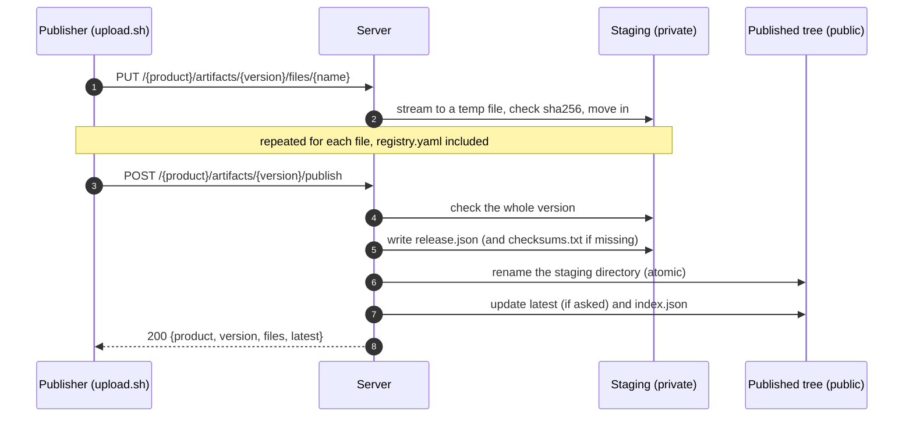

A version reaches the registry in two steps: you **upload** its files one by one into a private staging area, then you **publish** it. Publication checks the whole set and makes it visible at once. This page explains why, and what happens at each step.

## Why two steps

A release is a set of files that only make sense together: archives, a checksums file that covers them, a description. Uploading them one by one directly into the public tree would expose broken states: a checksums file without its archives, a half-written binary, a version that a crash leaves incomplete.

Staging removes that risk. Nothing is public until the server has seen and checked everything.

## The flow

### Upload

Each `PUT` sends one file, with the upload token.

- The body is streamed to a temporary file. It enters staging only once it is complete and checked: an interrupted upload leaves nothing behind.
- If you send `X-Checksum-Sha256`, the server compares it with what it received and refuses a mismatch.
- Uploading the same name again replaces the staged file. This is how you fix a mistake before publishing.
- `registry.yaml` and `CHANGELOG.md` are validated on arrival, so a malformed card is refused right away.
- With goreleaser, `artifacts.json` comes **last**: it is refused while a file it lists is missing.

### Publish

`POST …/publish` checks the staged version as a whole. The main checks:

| Check | Why |
| --- | --- |
| `registry.yaml` is there | Every version carries its product card |
| At least one artifact besides the card | A version must deliver something |
| Every file matches the checksums file, when one is uploaded | What is published is what was built |
| `artifacts.json`, when uploaded, lists exactly the staged files | Its paths will point to real files |
| `metadata.json`, when uploaded, describes this version | No mix-up between versions |

The complete, ordered list is in [Upload rules](../reference/upload-rules.md).

If every check passes, the server completes the version **in staging**: it writes `release.json`, rewrites `artifacts.json` paths into download URLs, and writes `checksums.txt` when you uploaded none. Then it renames the staging directory into the published tree.

## What makes it atomic

The rename is a single file-system operation. Before it, the version does not exist for readers; after it, it exists with every file. There is no in-between state to observe.

Two consequences for operators:

- Staging and the published tree live on the same file system, under `bin.local/`. Do not mount them separately, or renames stop being atomic.
- One server process owns one storage directory. The upload lock is in memory: two servers writing the same directory could interleave. See [Limitations](../limitations.md).

## When a publication is refused

Nothing is published and **staging is kept**. The answer says what is wrong, for example `422 registry.yaml not uploaded: every version needs its product card`. Upload the missing or corrected file under the same name and publish again; or simply rerun `upload.sh`.

Staged versions you abandon are not kept forever. With `--staging-ttl` (24 h by default), the server purges staged versions untouched for that long. See [Quotas and staging](../operations/quotas-and-staging.md).

## Related

- [Integrity](./integrity.md): the checksum checks in detail.
- [Latest version](./latest.md): what `latest=true` does.
- [Upload rules](../reference/upload-rules.md): every check and every error message.
