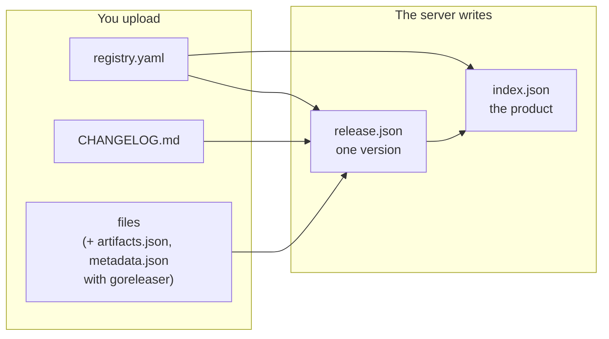

Files alone do not tell a client much: which archive is for Linux on ARM, what changed in this version, who owns the product. The `local-registry/v1` standard answers these questions with four small documents. You write one of them; the server writes the others.

## The four documents

| Document | Written by | Lives in | Answers |
| --- | --- | --- | --- |
| `registry.yaml` | **you**, required | each version | What is this product, who owns it, is this version deprecated? |
| `CHANGELOG.md` | goreleaser or you, optional | each version | What changed in this version? |
| `release.json` | the server, at publish | each version | What does this version contain, for which platform, with which checksums? |
| `index.json` | the server, at each publish | the product | Which versions exist, which one is latest, what does the product card say? |

Every document the server writes carries `"apiVersion": "local-registry/v1"`.

## What each one is for

**`registry.yaml`, the product card.** A short YAML file kept with the product's sources: display name, description, license, owners, links, keywords, labels, installation instructions, deprecation. Because it is uploaded with every version, the card evolves with the code and each version keeps the card it was published with. See [Write the product card](../guides/write-registry-yaml.md).

**`CHANGELOG.md`, the release notes.** Either the file goreleaser writes from your commit messages, or one you maintain in the Keep a Changelog format. The server extracts notes typed *added*, *changed*, *deprecated*, *removed*, *fixed* or *security*. See [Write release notes](../guides/write-changelog.md).

**`release.json`, one version.** The normalised description of a version: each file with its kind, format, platform, size, sha256, download URL and attached SBOM or signature; the checksums file; the release notes; who published it and when. It is written inside the version before publication, so it is as immutable as the files.

**`index.json`, the product.** The card of the latest version (or of the last one published) and the list of versions, newest first, with their pre-release, security and deprecation flags. It is rewritten after each publication of the product.

## Why it matters

| For… | The standard gives |
| --- | --- |
| **Consumers** | One stable JSON shape for every product, whatever produced it. No guessing file names, no parsing of goreleaser internals. |
| **Portals and inventories** | Owners, links, labels and licenses for every product, from `GET /products` and `GET /{product}/index`. |
| **Security teams** | `securityUpdates` on each version, and the SBOM and signature of each file when you publish them. |
| **Publishers** | One required file to write. goreleaser users get everything else for free; others get it inferred from their files. |

## Stability

`apiVersion` changes (to `local-registry/v2`) only for an incompatible change: a field removed or renamed, a type or a meaning changed. New fields, new kinds or new media types keep `v1`.

> [!IMPORTANT]
> Clients must ignore fields they do not know. That is what lets the standard grow without breaking you.

Every key of `release.json` and `index.json` is always present; an unknown value is `null`, never a missing key.

## Where to go next

- Field by field: [registry.yaml](../reference/registry-yaml.md), [release.json](../reference/release-json.md), [index.json](../reference/index-json.md), [Changelog format](../reference/changelog-format.md).
- The routes that serve these documents: [Products API](../reference/api/products.md).
- The normative text, as one file: `SPEC.md` at the root of the repository, with the JSON Schema `schema/registry.schema.json`.
