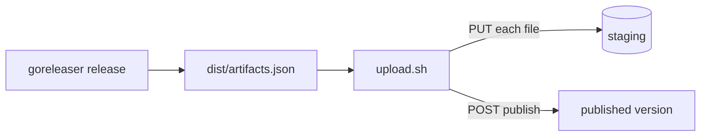

This guide publishes the output of `goreleaser release` as one version of a product. Use it when your project already builds with goreleaser: `scripts/upload.sh` reads goreleaser's `dist/artifacts.json`, so it works whatever your archive layout.



## Before you start

- A registry you can reach, for example `https://registry.example.com`, and its upload token. See [Configuration](../operations/configuration.md) if you run the server yourself.
- `bash` 3.2 or later, `curl` and `jq` on the machine that publishes.
- `scripts/upload.sh`. It ships in every local-registry release archive. Copy it into your repository, for example as `ci/upload.sh`, so every build uses the same version of it.
- A `registry.yaml` product card at the root of your project. The server refuses a version without it. See [Write the product card](write-registry-yaml.md).

> [!IMPORTANT]
> Publish **after** `goreleaser release` has finished. goreleaser writes `dist/artifacts.json` after its own `publishers:`, so a goreleaser publisher cannot send it.

## Steps

1. **Build the release.** From the root of your project, on a tag:

   ```sh
   git tag v1.4.2
   goreleaser release --clean
   ```

   If goreleaser must not create a GitHub or GitLab release, add `--skip=publish`. `dist/artifacts.json`, `dist/metadata.json` and `dist/CHANGELOG.md` are still written.

2. **Check what would be sent.** A dry run reads `artifacts.json`, checks that every file exists and that a product card is found, and sends nothing. It needs no URL and no token.

   ```sh
   ci/upload.sh --dry-run sonarbridge dist/artifacts.json
   ```

   ```
   == sonarbridge v1.4.2 from dist/artifacts.json (root /home/me/sonarbridge)
   PUT metadata.json <- /home/me/sonarbridge/dist/metadata.json
   PUT sonarbridge_1.4.2_linux_amd64.tar.gz <- /home/me/sonarbridge/dist/sonarbridge_1.4.2_linux_amd64.tar.gz (sha256 3f1c…)
   …
   PUT registry.yaml <- /home/me/sonarbridge/registry.yaml
   PUT CHANGELOG.md <- /home/me/sonarbridge/dist/CHANGELOG.md
   PUT artifacts.json <- dist/artifacts.json
   POST publish sonarbridge/v1.4.2 (latest=true)
   ```

   The version comes from the `tag` of `metadata.json`. Pass `--version` to choose another one.

3. **Publish.** Set the registry address and the token, then run the script without `--dry-run`. Add `--latest` to make this version the product's latest one.

   ```sh
   export LOCAL_REGISTRY_URL=https://registry.example.com
   export LOCAL_REGISTRY_UPLOAD_TOKEN=…   # from your secret store, never on the command line
   ci/upload.sh --latest sonarbridge dist/artifacts.json
   ```

   The script sends the token on curl's standard input, so it never shows in the process list. It ends with the server's answer:

   ```json
   {"product":"sonarbridge","version":"v1.4.2","files":["CHANGELOG.md","artifacts.goreleaser.json","artifacts.json",…],"latest":true}
   ```

## Check the result

```sh
curl -fsS https://registry.example.com/sonarbridge/releases/v1.4.2 | jq '{version, tag, changes, files: [.artifacts[].name]}'
curl -fsS https://registry.example.com/sonarbridge/index | jq '{latest, versions: [.versions[].version]}'
```

`release.json` lists every file with its platform, size and sha256. If you used `--latest`, `latest` in the index is now `v1.4.2`.

## What the script sends

- Every file that goreleaser marks as part of the release: archives, packages, checksums, signatures, certificates, SBOMs, `metadata.json`, and binaries published as is (`formats: [binary]`). Each file is sent with its sha256 when `artifacts.json` has one, and the server checks it on arrival.
- Raw build outputs (`Binary` entries without a format) are skipped. They are the files your archives are made from.
- `registry.yaml`, then `dist/CHANGELOG.md` when it exists, then `artifacts.json` last, as the server requires.

The script finds the files from the `path` fields of `artifacts.json`. It guesses the directory they are relative to. If it guesses wrong, it stops with `not found (wrong --root?)`: pass `--root` with goreleaser's working directory.

All options are in [Scripts](../reference/scripts.md).

## If something goes wrong

- **The script stops before sending anything.** A file is missing, two files share a name, or no `registry.yaml` was found. Fix the cause and run it again.
- **The server refuses the publish (`422`).** Nothing is published and the uploaded files stay in staging. Fix the cause and run the script again: it replaces the staged files. See [Staging and publish](../concepts/staging-and-publish.md).
- **`409 … already published`.** A version is immutable. Publish a new version.
- **`metadata.json describes …, not …`.** The version in the URL is not the goreleaser tag. Drop `--version`, or pass the tag.

Every message is explained in [Troubleshooting](../troubleshooting.md) and [Errors](../reference/errors.md).

## The other script

`scripts/publish-to-local-registry.sh [--latest] <product> [dist-dir]` is a POSIX `sh` script without `jq`. It only works when every file of the checksums file sits at the root of `dist-dir` under its published name, and it reads `registry.yaml` from the current directory. Prefer `upload.sh` in every other case, and on Windows.

## Next steps

- Automate it: [Publish from CI](ci-pipelines.md).
- Change which version is the latest one: [Change the latest version](change-latest.md).
