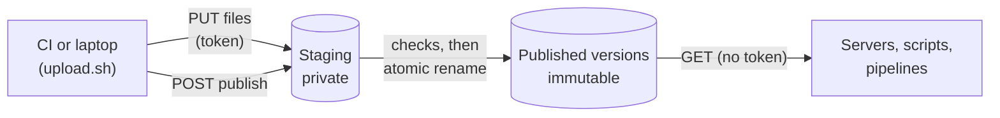

local-registry is a private release registry. Your teams publish versioned deliverables to it (Go binaries built by goreleaser, database migrations, configuration bundles, any file), and your machines, scripts and pipelines download them from it.

It is one static binary with no database: it stores everything on a plain directory and serves it over HTTP.

## Why use it

Most organisations need a place to keep internal releases that is not a public GitHub release page and not a full artifact manager. local-registry fills that gap with three promises:

| Promise | What it means for you |
| --- | --- |
| **A version appears whole, or not at all** | Files are uploaded to a private staging area, checked, then published in one atomic step. A client never sees half a release. |
| **What you download is what was built** | Every file is checked against its sha256 before publication. The checksums travel with the version. |
| **A published version never changes** | Once published, a version is immutable. Re-uploading answers `409 Conflict`. |

On top of the files, the server writes a normalised description of each version, `release.json`, and of each product, `index.json`. Clients read these documents instead of guessing file names. This is the [`local-registry/v1` standard](./concepts/standard-v1.md).

## How it works

1. A publisher uploads the files of a version, with an upload token.
2. It asks the server to publish. The server checks the files, writes `release.json`, and makes the version visible in one step.
3. Anyone on the network reads the catalogue and downloads files. Reads need no token.

The details are in [Staging and publish](./concepts/staging-and-publish.md).

## Who this documentation is for

| You are… | Start with |
| --- | --- |
| **A release or CI engineer** who publishes versions | [Quick start](./getting-started/quick-start.md), then [Your first goreleaser release](./getting-started/first-release-goreleaser.md) or [Publish files without goreleaser](./getting-started/first-release-files.md) |
| **A platform operator** who runs the server | [Install](./operations/install.md), [Configuration](./operations/configuration.md), [Security](./operations/security.md) |
| **An integrator** who consumes releases | [Consume releases](./guides/consume-releases.md) and the [HTTP API reference](./reference/api/index.md) |

## What it is not

Be clear about the scope before you adopt it:

- **Not a container or package registry.** It does not speak the Docker, npm, Maven or APT protocols. It serves files over plain HTTP.
- **Not access-controlled for reads.** Everything published is readable by anyone who can reach the server. Put it on a private network or behind a reverse proxy that authenticates. See [Security](./operations/security.md).
- **Not multi-node.** One server owns one storage directory. See [Limitations](./limitations.md).

> [!TIP]
> New to the vocabulary (product, version, staging, latest)? The [Glossary](./glossary.md) defines every term in one line.
