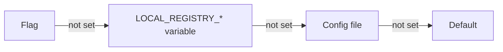

Every setting of `local-registry serve` can come from a flag, an environment variable or a YAML file. This page explains how they combine, how to check the result, and which settings matter in production. The full list of flags is in the [command-line reference](../reference/cli.md).

## Precedence

For each setting, the server takes the first source that defines it:

1. **Command-line flag**: `--port 9000`.
2. **Environment variable**: `LOCAL_REGISTRY_` followed by the flag name in upper case, with `-` replaced by `_`: `LOCAL_REGISTRY_PORT=9000`.
3. **Configuration file**, given by `--config` or `LOCAL_REGISTRY_CONFIG`: `port: 9000`.
4. **Default value.**



> [!IMPORTANT]
> A forgotten `LOCAL_REGISTRY_*` variable silently wins over the file. The container image sets `LOCAL_REGISTRY_ASSET_PATH`, `LOCAL_REGISTRY_ADDRESS` and `LOCAL_REGISTRY_PORT`: in a container, set those three through the environment, not the file.

The upload token is the only setting with no flag, because a flag would show the secret in `ps`. It comes from `LOCAL_REGISTRY_UPLOAD_TOKEN`, else from the `upload-token` key of the file.

## Configuration file

The file is YAML, with the same keys as the flags, plus `upload-token`. The server reads no file unless you pass `--config` or `LOCAL_REGISTRY_CONFIG`.

```yaml
# /etc/local-registry/config.yaml (mode 0600: it holds the token)
asset-path: /srv/registry
address: 0.0.0.0
port: 8443
tls-cert: /etc/local-registry/fullchain.pem
tls-key: /etc/local-registry/privkey.pem
public-url: https://registry.example.com:8443
max-version-mb: 4096
staging-ttl: 48h
audit-log: /var/log/local-registry/audit.log
upload-token: replace-with-the-output-of-openssl-rand-hex-32
```

The file is checked strictly:

- **Unknown keys are refused**, with the exit code `2`: a typo such as `max-verion-mb` stops the server instead of being ignored. Nested keys are refused too.
- **A token in a file other users can read** starts the server with a warning: `warning: <file> holds the upload token but is readable by other users (mode -rw-r--r--): chmod 600 <file>`.
- **Values are typed.** `port: abc` or `staging-ttl: 2 days` stop the server with a clear message, instead of becoming `0`.

### Paths

`config`, `asset-path`, `tls-cert`, `tls-key` and `audit-log` expand `$VAR`, `${VAR}`, `~` and `~/`, whatever their source. This matters where no shell runs: a configuration file, a systemd unit, a single-quoted argument.

- An unset variable is an error, not an empty string: `$HOMEE/registry` never becomes `/registry`.
- `~user` is refused.
- Relative paths are resolved from the working directory of the process, not from the directory of the file. Use absolute paths.

## Check the effective configuration

`local-registry config` resolves the configuration exactly like `serve`, validates it, and prints each setting with its source. It starts nothing, so you can run it before every restart.

```sh
local-registry config --config /etc/local-registry/config.yaml
```

```
SETTING                 VALUE                               SOURCE
config                  /etc/local-registry/config.yaml     flag
asset-path              /srv/registry                       config file
address                 0.0.0.0                             config file
port                    8443                                config file
tls-cert                /etc/local-registry/fullchain.pem   config file
tls-key                 /etc/local-registry/privkey.pem     config file
max-upload-mb           200                                 default
max-version-mb          4096                                config file
max-version-files       50                                  env LOCAL_REGISTRY_MAX_VERSION_FILES
max-staging-mb          10240                               default
min-free-mb             1024                                default
staging-ttl             48h0m0s                             config file
audit-log               /var/log/local-registry/audit.log   config file
public-url              https://registry.example.com:8443   config file
disable-generate-token  true                                default
upload-token            set (token_id e2186dbdb1bb)         config file
```

- `-` in the `VALUE` column means empty.
- The token is never printed. You see whether it is set and its `token_id`, the identifier the logs use. See [Security](security.md).

## Settings to review before production

| Setting | Default | Why it matters |
| --- | --- | --- |
| `asset-path` | none, **required** | All data lives there. The server never falls back to the working directory, which would publish whatever it holds. |
| `address` | `localhost` | Only local clients can connect by default. Set `0.0.0.0` (or one interface) to serve the network. |
| `port` | `8077` | `0` picks a free port: useful in tests only. |
| `tls-cert`, `tls-key` | none | Both or neither. With them, the server speaks HTTPS only. Without them, put a TLS reverse proxy in front. See [Security](security.md). |
| `public-url` | none | The address clients use, such as `https://registry.example.com`. It makes download URLs absolute. Set it whenever the server sits behind a proxy or another host name. `artifacts.json` and `release.json` are written at publish time, so they change only for versions published after you set it; `POST /releases/…` uses it at once. |
| `upload-token` | none | Without it, the registry is read-only: upload routes answer `403`. |
| `audit-log` | `<asset-path>/bin.local/audit.log` | Move it to your log volume if you collect logs there. It cannot be placed in a public tree. See [Audit log](audit-log.md). |
| Quotas and `staging-ttl` | see [Quotas and staging](quotas-and-staging.md) | Protect the disk from oversized or abandoned uploads. |

### Generated token for a trial

`--disable-generate-token=false` makes `serve` generate a random token at startup when none is configured, and print it on standard output only. The token changes at each start. Use it to try the registry, not in production: standard output is often kept by systemd, Docker, Kubernetes or CI logs.

Boolean flags take `=`: write `--disable-generate-token=false`, not `--disable-generate-token false`.

## Configuration errors

Any configuration error stops the program before it listens, with `Error: <message>` and the exit code `2`. The most common ones:

| Message | Fix |
| --- | --- |
| `asset-path is required (…)` | Set `--asset-path`, `LOCAL_REGISTRY_ASSET_PATH` or `asset-path`. |
| `asset-path <dir> is not an existing directory` | Create the directory first. |
| `tls-cert and tls-key go together` | Set both, or neither. |
| `staging-ttl must be 0 or at least 1h0m0s` | An upload may last 30 minutes: a shorter TTL could purge it while it runs. |
| `audit-log … would be downloadable: put it outside bin.local/assets and assets` | Move the audit log out of the public trees. |
| `public-url "…" must be an http or https URL with no user, query or fragment, …` | Use a plain address such as `https://registry.example.com` (a path prefix is allowed). |
| `config file <file>: unknown setting "…"` | Fix the key name. |

The complete list is in the [command-line reference](../reference/cli.md).

## Apply a change

The server reads its configuration and its TLS certificate once, at startup. To apply a change, restart it. A restart drains running requests for up to 10 seconds; uploads still in staging survive the restart.
