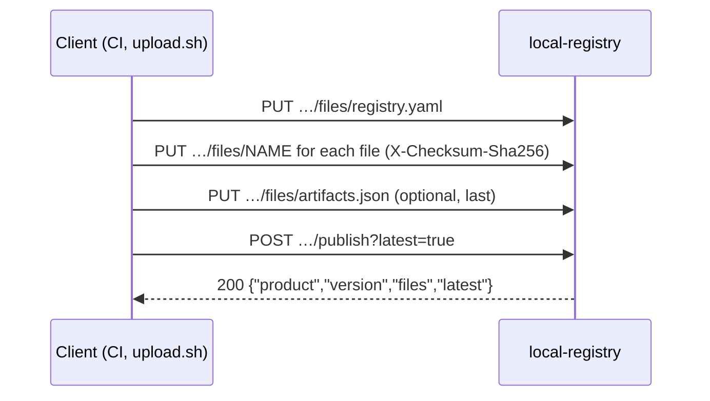

A version is published in two steps: upload each file to the staging area of the version, then publish it. Publishing checks the staged files as a whole and makes the version visible in one operation; until then, nothing is public. The concept is explained in [Staging and publish](../../concepts/staging-and-publish.md); the scripts that do it for you are in [Scripts](../scripts.md).



## Authentication

Both routes require the upload token configured on the server (`LOCAL_REGISTRY_UPLOAD_TOKEN` or `upload-token`), sent as a bearer token. It is checked in constant time, before anything else.

```
Authorization: Bearer <token>
```

| Situation | Answer |
| --- | --- |
| The server has no token configured | `403 upload is disabled: no token configured` |
| Header missing, another scheme, or wrong token | `401 invalid or missing bearer token`, with `WWW-Authenticate: Bearer` |

Every attempt is recorded in the [audit log](../../operations/audit-log.md), refused ones included; the token itself never is, only its `token_id`.

Send the header on curl's standard input, so the token does not appear in the process list:

```sh
auth() { printf 'Authorization: Bearer %s\n' "$LOCAL_REGISTRY_UPLOAD_TOKEN"; }
auth | curl -fsS -H @- …
```

## Upload a file

`PUT /{product}/artifacts/{version}/files/{name}`

Streams one file into the staging area of `<product>/<version>`. Nothing is visible before publish.

| Parameter | In | Description |
| --- | --- | --- |
| `product` | path | Product name. `products` is reserved. |
| `version` | path | Version name. `latest`, `artifacts.json`, `artifacts.goreleaser.json`, `release.json` and `index.json` are refused. |
| `name` | path | Published file name. `artifacts.goreleaser.json`, `release.json` and `index.json` are reserved: the server writes them. |
| `Authorization` | header | `Bearer <token>`. |
| `X-Checksum-Sha256` | header, optional | Expected sha256 of the body, hex, any case. A mismatch refuses the file (`422`) and keeps nothing. |
| body | — | Raw file content (`curl -T file`). Not multipart: `curl -F` would store the multipart envelope. |

```sh
f=billing-db-migrations_1.0.0.tar.gz
auth | curl -fsS -H @- -H "X-Checksum-Sha256: $(shasum -a 256 "$f" | cut -d' ' -f1)" \
  -T "$f" "https://registry.example.com/billing-db-migrations/artifacts/v1.0.0/files/$f"
```

`201 Created`:

```json
{"name": "billing-db-migrations_1.0.0.tar.gz", "size": 2311, "sha256": "6c08926d953d80ba627847e1b3eaa893e6040e239a197083f83cda85341baa00"}
```

| Field | Content |
| --- | --- |
| `name` | File name in staging. |
| `size` | Bytes received. |
| `sha256` | sha256 of the bytes received, hex. |

Behaviour:

- The body is streamed to `bin.local/.uploads-tmp/`, then moved into staging once complete and checked. An interrupted or refused upload leaves nothing behind.
- Uploading the same name again replaces the staged file.
- `registry.yaml` is validated on receipt (see [registry.yaml](../registry-yaml.md)); `CHANGELOG.md` must be UTF-8 text of at most 1 MiB.
- **`artifacts.json`, when you send one, must be uploaded last.** On receipt, every file it publishes must already be staged, with the sha256 of its `extra.Checksum`. Uploading it again checks it again.
- The request may last up to 30 minutes.

Errors, in the order they are checked:

| Status | Message |
| --- | --- |
| `403`, `401` | See [Authentication](#authentication). |
| `400` | `invalid product or version name` |
| `400` | `product name products is reserved` |
| `400` | `version name <version> is reserved` |
| `400` | `invalid file name: use [A-Za-z0-9._-] only` |
| `400` | `<name> is reserved: publishing writes it` |
| `409` | `version <product>/<version> is already published and cannot be changed` |
| `422` | `version <product>/<version> already has <n> staged files (limit <n>)` (replacing a staged file is still allowed) |
| `413` | `file exceeds <bytes> bytes` |
| `413` | `version <product>/<version> would exceed its staging quota of <bytes> bytes` |
| `507` | `upload staging area is full (limit <bytes> bytes): publish or abandon pending versions` |
| `507` | `not enough free disk space on the registry` |
| `422` | `sha256 mismatch: got <actual>, X-Checksum-Sha256 says <expected>` |
| `422` | `registry.yaml: <reason>`, `registry.yaml is larger than 64 KiB` |
| `422` | `CHANGELOG.md is larger than 1 MiB`, `CHANGELOG.md is not UTF-8 text` |
| `422` | `artifacts.json …`: see [Upload rules](../upload-rules.md) |
| `500` | `internal error` (disk error, client disconnected) |

The quotas are described in [Quotas and staging](../../operations/quotas-and-staging.md); every message, with its cause and fix, is in [Errors](../errors.md).

## Publish a version

`POST /{product}/artifacts/{version}/publish`

Checks the staged files of `<product>/<version>`, writes the version's documents, then makes the version visible in one rename. No request body.

| Parameter | In | Description |
| --- | --- | --- |
| `product`, `version` | path | As for the upload. |
| `latest` | query, optional | `true`: also make this version the product's latest. Accepts `true`/`false`, `1`/`0`, `t`/`f`, any case. Default `false`. |
| `Authorization` | header | `Bearer <token>`. |

```sh
auth | curl -fsS -H @- -X POST "https://registry.example.com/billing-db-migrations/artifacts/v1.0.0/publish?latest=true"
```

`200 OK`:

```json
{
  "product": "billing-db-migrations",
  "version": "v1.0.0",
  "files": ["CHANGELOG.md", "billing-db-migrations_1.0.0.tar.gz", "checksums.txt", "registry.yaml", "release.json"],
  "latest": true
}
```

| Field | Content |
| --- | --- |
| `product`, `version` | The published version. |
| `files` | Every file of the published version, sorted, including those the server wrote (`release.json`, `artifacts.goreleaser.json`, a generated `checksums.txt`). |
| `latest` | Whether the version was made latest. |

What is checked, and what happens after, step by step, is in [Upload rules](../upload-rules.md). In short: `registry.yaml` is required; `artifacts.json`, `metadata.json` and the checksums file are optional but checked when present; at least one artifact is needed. When a check fails, nothing is published and staging is kept: fix the file, upload it again and call publish again.

Errors:

| Status | Message |
| --- | --- |
| `403`, `401` | See [Authentication](#authentication). |
| `400` | `invalid product or version name`, `product name products is reserved`, `version name <version> is reserved` |
| `400` | `latest must be true or false` |
| `409` | `version <product>/<version> is already published and cannot be changed` |
| `404` | `nothing uploaded for <product>/<version>` |
| `422` | `several checksums files: <a> and <b>` |
| `422` | `registry.yaml not uploaded: every version needs its product card` |
| `422` | `<checksums>: line <n> is not "<sha256>  <name>"` |
| `422` | `<name> is not listed in <checksums>` |
| `422` | `<name>: sha256 is <actual> but <checksums> says <expected>` |
| `422` | `metadata.json is not valid JSON`, `metadata.json has neither tag nor version` |
| `422` | `metadata.json describes <tag> (version <version>), not <version>` |
| `422` | `artifacts.json …`: see [Upload rules](../upload-rules.md) |
| `422` | `<name> is uploaded but artifacts.json does not list it` |
| `422` | `no artifact to publish: upload at least one file besides registry.yaml` |
| `500` | `internal error`. When it happens after the rename, the version **is** published; the server log says `version published but latest not updated` or `version published but index.json not updated`. |

> [!WARNING]
> A published version is immutable: any later `PUT` or `publish` for it answers `409`. To ship a fix, publish a new version.
