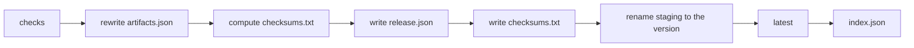

This page is the exact contract of `POST /{product}/artifacts/{version}/publish`: the checks it runs on the staged files, in order, and the steps it then takes. If any check fails, nothing is published and staging is kept as it is: fix the cause, upload the corrected file under the same name, and publish again. For the request itself, see [Upload API](./api/upload.md).

## Files of a version

| File | Required | Written by | Notes |
| --- | --- | --- | --- |
| `registry.yaml` | **yes** | the team | The product card. See [registry.yaml](./registry-yaml.md). |
| at least one artifact | **yes** | build | Archive, binary, package, or any other file. |
| `CHANGELOG.md` | no | goreleaser or the team | Release notes. See [CHANGELOG.md](./changelog-format.md). |
| `*checksums.txt` | no | goreleaser | At most one. Without it, publish writes `checksums.txt`. |
| `metadata.json` | no | goreleaser | Gives `tag`, `commit`, `builtAt`… |
| `artifacts.json` | no | goreleaser, or by hand | Gives each file's type and platform. Uploaded last. |
| signatures, certificates, SBOMs | no | build | Attached to the file they cover. |
| `release.json`, `artifacts.goreleaser.json`, `index.json` | — | **the server** | Reserved: uploading them answers `400`. |

## Checks

They run in this order; the first failure answers.

| # | Check | Failure |
| --- | --- | --- |
| 1 | `{product}` and `{version}` are valid names, not reserved; `latest` is a boolean. | `400` |
| 2 | The version is not already published. | `409 version <product>/<version> is already published and cannot be changed` |
| 3 | Something is staged for the version. | `404 nothing uploaded for <product>/<version>` |
| 4 | At most one checksums file (name ending in `checksums.txt`, any case). | `422 several checksums files: <a> and <b>` |
| 5 | `registry.yaml` is staged. | `422 registry.yaml not uploaded: every version needs its product card` |
| 6 | With a checksums file: each line is `<64-hex sha256>  <name>` (`*name` accepted; blank lines ignored). | `422 <checksums>: line <n> is not "<sha256>  <name>"` |
| 7 | With a checksums file: every staged file is listed with a matching sha256, except the checksums file itself, `registry.yaml`, `CHANGELOG.md`, `metadata.json`, the files the server writes, and `*.sig`, `*.pem`, `*.sigstore.json`. Lines naming files that were not uploaded are allowed. | `422 <name> is not listed in <checksums>`, `422 <name>: sha256 is <actual> but <checksums> says <expected>` |
| 8 | With `metadata.json`: it is a JSON object with `tag` or `version`, and `{version}` equals `tag`, `version`, or `v` + `version`. | `422 metadata.json is not valid JSON`, `422 metadata.json has neither tag nor version`, `422 metadata.json describes <tag> (version <v>), not <version>` |
| 9 | With `artifacts.json`: it passes the [artifacts.json checks](#artifactsjson-checks) again, which catches a file removed or replaced after it was uploaded. | `422 artifacts.json …` |
| 10 | With `artifacts.json`: every staged file is one of its published entries, except `registry.yaml`, `CHANGELOG.md` and `metadata.json`. | `422 <name> is uploaded but artifacts.json does not list it` |
| 11 | At least one artifact: a file of its own, not only `registry.yaml`, `CHANGELOG.md`, `metadata.json`, checksums or attachments. | `422 no artifact to publish: upload at least one file besides registry.yaml` |
| 12 | `registry.yaml` and `metadata.json` can be read into `release.json`. | `422 registry.yaml: <reason>`, `422 metadata.json is not valid JSON` |

## Steps after the checks

Steps 1 and 2 run as soon as checks 9 and 10 have passed, before checks 11 and 12. They only touch staging: if a later check fails, the next publish starts again from the uploaded `artifacts.json`, kept as `artifacts.goreleaser.json`.



1. **artifacts.json** (when uploaded): the uploaded file is kept as `artifacts.goreleaser.json` and replaced by its [rewrite](#artifactsjson-rewrite).
2. **checksums.txt** (when no checksums file was uploaded): computed from the staged files, in goreleaser's format: one `<sha256>  <name>` line per file that needs one (the same files as check 7), sorted by name.
3. **release.json** is written into staging. See [release.json](./release-json.md).
4. The computed `checksums.txt` is written into staging.
5. **Rename.** The staging directory `bin.local/.uploads/<product>/<version>/` is renamed to `bin.local/assets/binaries/<product>/<version>/`: the version appears complete, in one operation.
6. **Latest** (with `latest=true`): the version's `artifacts.json` is copied to `<product>/artifacts.json`, or that copy is removed when the version has none; then its `release.json` is copied to `<product>/release.json`, written last because it is the mark that designates the latest version. Each copy is atomic (temporary file, then rename). See [Latest](../concepts/latest.md).
7. **index.json**: `<product>/index.json` is rewritten atomically. See [index.json](./index-json.md).

A failure in step 6 or 7 answers `500 internal error`, but the version **is** published: the server log says `version published but latest not updated` or `version published but index.json not updated`. Fix the cause (disk, permissions) and set latest by hand if needed (see [Change the latest version](../guides/change-latest.md)); the index is rebuilt by the next publish, and `GET /{product}/index` never depends on it.

## artifacts.json checks

These run when `artifacts.json` is uploaded, and again at publish (check 9).

An entry is a **published file** when its `type` is `Archive`, `File`, `Source`, `Linux Package`, `Checksum`, `Signature`, `Certificate`, `SBOM` or `Metadata`, or `Binary` **with** `extra.Format` (goreleaser `formats: [binary]`). Other entries are ignored, notably `Binary` without `extra.Format`: the raw build output an archive is made from, never in the checksums file, often several with the same name.

| Rule | `422` message |
| --- | --- |
| A JSON array of objects, at most 32 MiB | `artifacts.json is not a JSON array of objects`, `artifacts.json: entry <i> is null`, `artifacts.json is larger than 32 MiB` |
| `name`, `path` and `type` are strings | `artifacts.json: name, path and type must be strings: <reason>` |
| Each published file has a name | `artifacts.json: a <type> entry has no name` |
| No published name appears twice | `artifacts.json lists <name> twice` |
| Each name is valid and not reserved (`artifacts.json`, `artifacts.goreleaser.json`, `release.json`, `index.json`) | `artifacts.json lists "<name>", a name that cannot be uploaded` |
| Each published file is staged | `artifacts.json references <name>, which is not uploaded: upload every file first, artifacts.json last` |
| Its sha256 matches `extra.Checksum` when that starts with `sha256:` | `<name>: sha256 is <actual> but artifacts.json says <expected>` |

## artifacts.json rewrite

The published `artifacts.json` keeps only the published entries, in their original order. In each entry only `path` changes: it becomes the file's download URL, `/{product}/artifacts/{version}/files/{name}`, under `--public-url` when it is set. The other fields are kept as uploaded; keys are sorted alphabetically and indented by 2 spaces.

Uploaded entry:

```json
{"name": "sonarbridge_1.4.2_linux_amd64.tar.gz", "path": "dist/sonarbridge_1.4.2_linux_amd64.tar.gz",
 "goos": "linux", "goarch": "amd64", "goamd64": "v1", "internal_type": 1, "type": "Archive",
 "extra": {"Checksum": "sha256:3f1c…", "Format": "tar.gz", "ID": "sonarbridge"}}
```

Published entry, with `--public-url https://registry.example.com`:

```json
{"extra": {"Checksum": "sha256:3f1c…", "Format": "tar.gz", "ID": "sonarbridge"},
 "goamd64": "v1", "goarch": "amd64", "goos": "linux", "internal_type": 1, "name": "sonarbridge_1.4.2_linux_amd64.tar.gz",
 "path": "https://registry.example.com/sonarbridge/artifacts/v1.4.2/files/sonarbridge_1.4.2_linux_amd64.tar.gz", "type": "Archive"}
```

## Guarantees

| Guarantee | Mechanism |
| --- | --- |
| A file being received is never visible | It is received in `bin.local/.uploads-tmp/`, then moved into staging once complete and checked. |
| A version appears complete or not at all | Publish renames the staging directory in one operation. |
| Published files match their checksums | Every file is checked against the uploaded checksums file; without one, publish writes it from the staged files. |
| `artifacts.json` paths point to the version's files | Rewritten in staging, before the rename, after checking each file it lists. |
| Latest changes in one step | `<product>/release.json` is replaced atomically, after `<product>/artifacts.json`. |
| A published version never changes | `PUT` and publish answer `409`. |
| Parallel uploads cannot exceed a quota together | Quotas are checked again under the upload lock. |

> [!IMPORTANT]
> Renames are atomic only because `bin.local/.uploads-tmp`, `bin.local/.uploads` and `bin.local/assets` sit on the same file system: do not mount them separately. The upload lock is held by one process: run a single uploading server per asset path.
