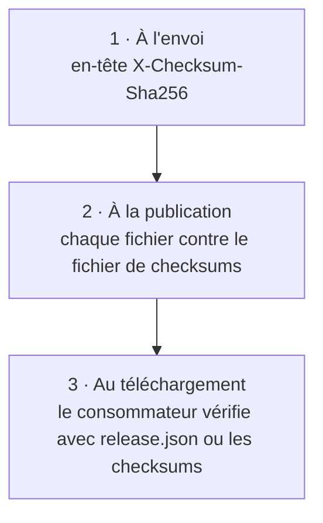

Un registre n'est utile que si l'on peut se fier à ce qu'on y télécharge. local-registry contrôle chaque fichier avant de le publier, enregistre son sha256 et donne aux consommateurs de quoi le vérifier eux-mêmes. Cette page décrit les contrôles, et ce qui reste de votre responsabilité.

## Trois niveaux de contrôle



**1. À l'envoi.** Chaque `PUT` peut porter le sha256 calculé par l'éditeur, dans `X-Checksum-Sha256`. Le serveur calcule celui de ce qu'il reçoit et refuse toute différence (`422 sha256 mismatch`) avant que le fichier n'entre en staging. `upload.sh` l'envoie toujours quand il le connaît : pour chaque fichier d'un dossier, et pour les fichiers goreleaser dont l'entrée en note un.

**2. À la publication.** Le serveur recalcule le sha256 de chaque fichier en staging et compare la version entière au fichier de checksums :

- Si vous avez envoyé un fichier de checksums (`*checksums.txt`, celui de goreleaser par exemple), chaque fichier doit y figurer avec le même sha256. Un fichier absent ou différent fait refuser la publication.
- Si vous n'en avez envoyé aucun, le serveur écrit lui-même `checksums.txt`, au même format `<sha256>  <nom>`, à partir des fichiers qu'il vient de vérifier.

Dans les deux cas, une version publiée a toujours un fichier de checksums cohérent avec ses fichiers.

**3. Au téléchargement.** Le consommateur compare ce qu'il a téléchargé au sha256 indiqué dans `release.json`, ou dans le fichier de checksums :

```sh
curl -fsSLO https://registry.example.com/sonarbridge/artifacts/v1.4.2/files/sonarbridge_1.4.2_linux_amd64.tar.gz
curl -fsSL  https://registry.example.com/sonarbridge/artifacts/v1.4.2/files/sonarbridge_1.4.2_checksums.txt |
  sha256sum --check --ignore-missing
```

Voir [Consommer les versions](../guides/consume-releases.md) pour des scripts clients complets.

## Les fichiers sans ligne de checksum

Quelques fichiers ne figurent pas dans le fichier de checksums, par conception : la fiche produit (`registry.yaml`), les notes de version (`CHANGELOG.md`), le `metadata.json` de goreleaser, les documents écrits par le serveur, et les signatures (`*.sig`, `*.pem`, `*.sigstore.json`), qui signent le fichier de checksums lui-même. Leur sha256 est malgré tout enregistré dans le [journal d'audit](../operations/audit-log.md) à la publication.

## Signatures et SBOM

Quand vous publiez des signatures, des certificats ou des SBOM (`signs:` et `sboms:` de goreleaser), le serveur rattache chacun au fichier qu'il couvre, d'après son nom : `<fichier>.sig`, `<fichier>.pem`, `<fichier>.sbom.json` et équivalents. `release.json` donne alors, pour chaque fichier, les URLs de son `sbom`, de sa `signature` et de son `certificate`, et de même pour le fichier de checksums.

> [!IMPORTANT]
> Le serveur rattache les signatures ; il ne les vérifie pas. Vérifier une signature (avec cosign ou gpg) selon votre politique de confiance revient au consommateur. Signer le fichier de checksums est le plus efficace : une seule signature couvre tous les fichiers.

## Ce dont le registre ne vous protège pas

Les limites, sans détour :

| Menace | Couverte ? |
| --- | --- |
| Un fichier corrompu en route vers le registre, ou un mauvais fichier envoyé | **Oui**, par les contrôles à l'envoi et à la publication |
| Un fichier publié modifié par l'API | **Oui** : les versions publiées sont immuables |
| Quelqu'un ayant un accès en écriture au dossier de stockage qui modifie un fichier | **Non** : protégez le dossier et sauvegardez-le. Voir [Stockage et sauvegarde](../operations/storage-and-backup.md) |
| Un fichier altéré sur le réseau vers le consommateur | **Seulement avec HTTPS**, ou en vérifiant les signatures. Voir [Sécurité](../operations/security.md) |
| Un build malveillant publié avec un token valide | **Non** : protégez le token, signez vos versions |

## Voir aussi

- [Staging et publication](./staging-and-publish.md)
- [Règles d'upload](../reference/upload-rules.md)
