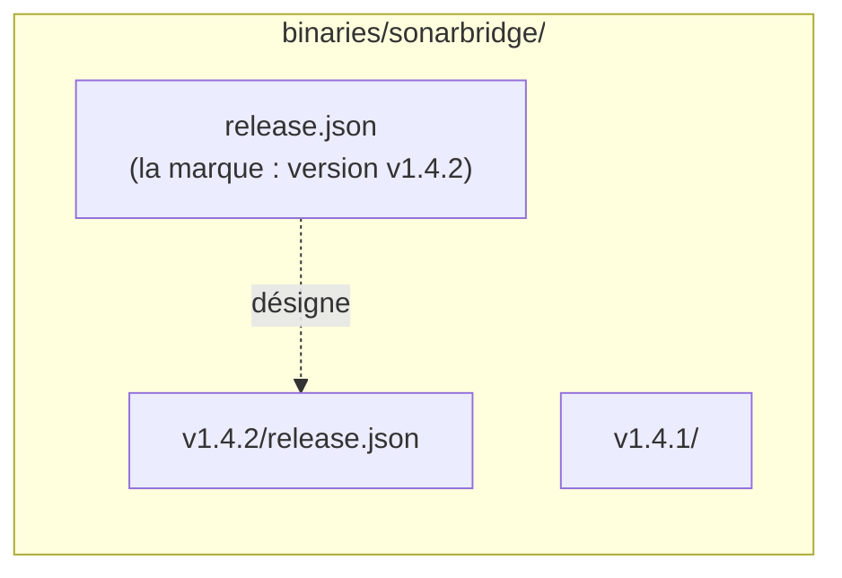

Chaque produit peut avoir une **dernière version** (latest) : celle qu'obtiennent les clients quand ils demandent `latest` au lieu d'un numéro. Cette page explique comment elle est désignée et ce que cela implique pour les éditeurs et les consommateurs.

## Latest est une décision, pas un calcul

Le registre ne déduit jamais latest des numéros de version. Une version devient latest seulement quand son éditeur le demande :

```sh
scripts/upload.sh --latest sonarbridge dist/artifacts.json
# ou, à la main : POST /sonarbridge/artifacts/v1.4.2/publish?latest=true
```

C'est voulu. Le numéro le plus haut n'est pas toujours celui à déployer :

- une pré-version `v1.5.0-rc.1` ne doit pas partir en production par accident ;
- un correctif `v1.4.3` publié après `v1.5.0` ne doit pas prendre sa place ;
- vous pouvez vouloir publier une version, la tester, puis la promouvoir plus tard.

Publier sans `--latest` laisse la dernière version actuelle en place.

## Comment le serveur l'enregistre

Avec `latest=true`, juste après la publication, le serveur copie le `release.json` de la version dans le dossier du produit :



Cette copie est la **marque**. La dernière version est la `version` qu'elle nomme, à condition que cette version soit publiée et ait son propre `release.json`. Sinon, le produit n'a pas de dernière version.

Le serveur copie aussi l'`artifacts.json` de la version à côté de la marque, pour les clients goreleaser qui le lisent directement. Si la nouvelle dernière version n'a pas d'`artifacts.json`, l'ancienne copie est supprimée : les deux ne se contredisent jamais.

La marque est écrite dans un fichier temporaire puis renommée : les lecteurs voient l'ancienne latest ou la nouvelle, jamais un mélange.

## Comment les clients la résolvent

Ces routes acceptent `latest` à la place d'une version :

| Route | Renvoie |
| --- | --- |
| `GET /{product}/releases/latest` | Le `release.json` de la dernière version |
| `GET /{product}/index` | Le champ `latest` la nomme (`null` s'il n'y en a pas) |
| `GET /products` | La `latest` de chaque produit |
| `GET /{product}/artifacts` | L'`artifacts.json` de la dernière version, si elle en a un |
| `POST /releases/{product}/latest` | Les fichiers de la dernière version et leurs URLs |

> [!IMPORTANT]
> Les téléchargements n'acceptent pas `latest` : `/{product}/artifacts/latest/files/{name}` répond `404`. Résolvez d'abord latest par `release.json`, puis téléchargez les URLs qu'il liste. Une URL de téléchargement désigne donc toujours une version exacte et immuable.

```sh
url=$(curl -fsS https://registry.example.com/sonarbridge/releases/latest |
  jq -r '.artifacts[] | select(.os == "linux" and .arch == "amd64") | .url')
curl -fsSLO "https://registry.example.com$url"   # URL relative ; absolue si le serveur définit --public-url
```

Si le produit n'a pas de dernière version, ces routes répondent `404` (et l'index indique `"latest": null`).

## Changer latest après coup

Pour promouvoir une version publiée sans `--latest`, ou revenir à une version plus ancienne, copiez le `release.json` de cette version sur la marque. Il n'existe pas encore d'API pour cela. Voir [Changer la dernière version](../guides/change-latest.md).

> [!NOTE]
> Les versions publiées avant l'existence de `release.json` ne peuvent pas être latest : elles n'ont rien à copier.

## Voir aussi

- [Produits et versions](./products-and-versions.md)
- [Consommer les versions](../guides/consume-releases.md)
