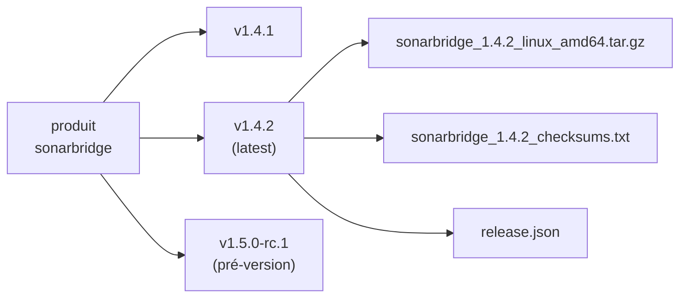

Tout ce qui est sur le registre appartient à un **produit**, et chaque produit est une suite de **versions**. Ces deux notions suffisent pour lire n'importe quelle URL de l'API.

## Produit

Un produit, c'est ce qu'une équipe livre et versionne : un outil en ligne de commande (`sonarbridge`), un agent (`billing-agent`), des migrations de base (`billing-db-migrations`), un paquet de règles (`security-policies`).

- Vous ne déclarez pas un produit à l'avance. Il existe dès que sa première version est publiée.
- Son nom est le premier segment de chaque URL : `/sonarbridge/…`.
- Il est décrit par une **fiche produit**, le `registry.yaml` envoyé avec chaque version. Voir [Le standard local-registry/v1](./standard-v1.md).

## Version

Une version est une livraison publiée d'un produit, en général nommée d'après son tag git : `v1.4.2`.



Une version est **immuable**. Une fois publiée, l'API ne permet ni d'ajouter, ni de remplacer, ni de retirer un fichier : un envoi répond `409 Conflict`. Pour livrer un correctif, publiez une nouvelle version.

> [!NOTE]
> L'immuabilité est ce qui rend une version digne de confiance. Un déploiement qui a figé `v1.4.2` le mois dernier obtient exactement les mêmes octets aujourd'hui.

### Pré-versions

Une version dont le nom est une pré-version semver (`v1.5.0-rc.1`, `2.0.0-beta`) porte `prerelease: true` dans sa description. Le registre ne la traite pas autrement : c'est vous qui décidez si elle devient la [dernière version](./latest.md).

### Dépréciation

La fiche produit peut marquer la version qu'elle accompagne comme dépréciée, avec `deprecated: true` ou un message comme `"remplacé par sonarbridge2"`. Le marqueur vaut pour une version : il apparaît dans son `release.json` et dans son entrée de l'index du produit.

## Noms

Les noms de produit, de version et de fichier suivent la même règle, choisie pour être sûre dans une URL et sur tout système de fichiers :

| Règle | |
| --- | --- |
| Caractères | `A–Z a–z 0–9 . _ -` uniquement |
| Interdits | `.` et `..` |
| Nom de produit réservé | `products` |
| Noms de version impossibles à publier | `latest`, `artifacts.json`, `artifacts.goreleaser.json`, `release.json`, `index.json` |

Un nom hors de ces règles répond `404` sur les routes de lecture et `400` sur les routes d'upload. En lecture, `latest` est accepté et désigne la [dernière version](./latest.md).

**Recommandé :** des produits en minuscules avec des tirets (`billing-db-migrations`), des versions en tags semver avec un `v` (`v1.4.2`). L'index trie les versions semver par précédence, la plus récente d'abord ; les autres noms suivent, de la plus récemment publiée à la plus ancienne.

## Lire une URL

Chaque route se construit avec ces noms :

```
https://registry.example.com/sonarbridge/artifacts/v1.4.2/files/sonarbridge_1.4.2_linux_amd64.tar.gz
                             └─produit──┘          └version┘     └──────────nom du fichier──────────┘
```

| URL | Renvoie |
| --- | --- |
| `/products` | Tous les produits |
| `/sonarbridge/index` | La fiche produit et ses versions |
| `/sonarbridge/releases/v1.4.2` | La description d'une version |
| `/sonarbridge/releases/latest` | La description de la dernière version |
| `/sonarbridge/artifacts/v1.4.2/files/<nom>` | Un fichier |

La liste complète est dans la [référence de l'API HTTP](../reference/api/index.md).

## Voir aussi

- [Staging et publication](./staging-and-publish.md) : comment une version naît.
- [Dernière version](./latest.md) : comment une version est désignée comme courante.
