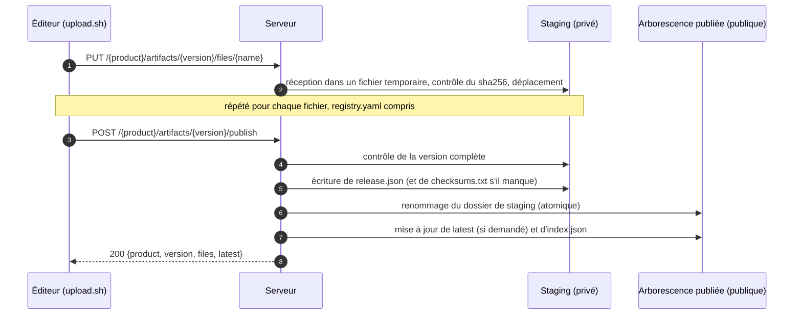

Une version arrive sur le registre en deux temps : vous **déposez** ses fichiers un par un dans une zone privée, le staging, puis vous la **publiez**. La publication contrôle l'ensemble et le rend visible d'un coup. Cette page explique pourquoi, et ce qui se passe à chaque étape.

## Pourquoi deux temps

Une release est un ensemble de fichiers qui n'ont de sens qu'ensemble : des archives, un fichier de checksums qui les couvre, une description. Les déposer un à un directement dans l'arborescence publique exposerait des états incohérents : un fichier de checksums sans ses archives, un binaire à moitié écrit, une version laissée incomplète par une panne.

Le staging supprime ce risque. Rien n'est public tant que le serveur n'a pas tout reçu et tout contrôlé.

## Le déroulé

### Dépôt

Chaque `PUT` envoie un fichier, avec le token d'upload.

- Le contenu est écrit dans un fichier temporaire. Il n'entre en staging qu'une fois complet et contrôlé : un envoi interrompu ne laisse rien.
- Si vous envoyez `X-Checksum-Sha256`, le serveur le compare à ce qu'il a reçu et refuse toute différence.
- Renvoyer le même nom remplace le fichier en staging. C'est ainsi qu'on corrige une erreur avant de publier.
- `registry.yaml` et `CHANGELOG.md` sont validés à l'arrivée : une fiche mal formée est refusée tout de suite.
- Avec goreleaser, `artifacts.json` arrive **en dernier** : il est refusé tant qu'un fichier qu'il liste manque.

### Publication

`POST …/publish` contrôle la version en staging dans son ensemble. Les principaux contrôles :

| Contrôle | Pourquoi |
| --- | --- |
| `registry.yaml` est présent | Chaque version porte sa fiche produit |
| Au moins un artefact en plus de la fiche | Une version doit livrer quelque chose |
| Chaque fichier correspond au fichier de checksums, s'il a été envoyé | Ce qui est publié est ce qui a été construit |
| `artifacts.json`, s'il a été envoyé, liste exactement les fichiers en staging | Ses chemins pointeront vers de vrais fichiers |
| `metadata.json`, s'il a été envoyé, décrit bien cette version | Pas de confusion entre versions |

La liste complète et ordonnée est dans les [Règles d'upload](../reference/upload-rules.md).

Si tout passe, le serveur complète la version **dans le staging** : il écrit `release.json`, transforme les chemins d'`artifacts.json` en URLs de téléchargement et écrit `checksums.txt` si vous n'en avez envoyé aucun. Puis il renomme le dossier de staging dans l'arborescence publiée.

## Ce qui rend l'opération atomique

Le renommage est une seule opération du système de fichiers. Avant, la version n'existe pas pour les lecteurs ; après, elle existe avec tous ses fichiers. Il n'y a aucun état intermédiaire observable.

Deux conséquences pour l'exploitation :

- Le staging et l'arborescence publiée sont sur le même système de fichiers, sous `bin.local/`. Ne les montez pas séparément, sinon les renommages ne sont plus atomiques.
- Un processus serveur possède un dossier de stockage. Le verrou d'upload est en mémoire : deux serveurs écrivant dans le même dossier pourraient s'entremêler. Voir [Limites](../limitations.md).

## Quand une publication est refusée

Rien n'est publié et **le staging est conservé**. La réponse dit ce qui ne va pas, par exemple `422 registry.yaml not uploaded: every version needs its product card`. Envoyez le fichier manquant ou corrigé sous le même nom et publiez à nouveau, ou relancez simplement `upload.sh`.

Les versions abandonnées en staging ne restent pas indéfiniment. Avec `--staging-ttl` (24 h par défaut), le serveur purge les versions en staging inactives depuis cette durée. Voir [Quotas et staging](../operations/quotas-and-staging.md).

## Voir aussi

- [Intégrité](./integrity.md) : les contrôles de checksums en détail.
- [Dernière version](./latest.md) : ce que fait `latest=true`.
- [Règles d'upload](../reference/upload-rules.md) : chaque contrôle et chaque message d'erreur.
