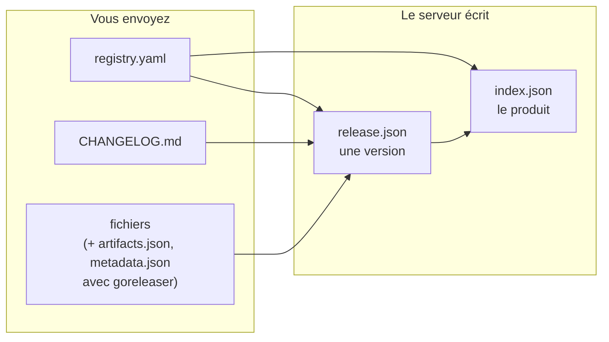

Les fichiers seuls n'en disent pas long à un client : quelle archive est pour Linux sur ARM, ce qui a changé dans cette version, qui est responsable du produit. Le standard `local-registry/v1` répond à ces questions avec quatre petits documents. Vous en écrivez un ; le serveur écrit les autres.

## Les quatre documents

| Document | Écrit par | Se trouve dans | Répond à |
| --- | --- | --- | --- |
| `registry.yaml` | **vous**, obligatoire | chaque version | Quel est ce produit, qui en est responsable, cette version est-elle dépréciée ? |
| `CHANGELOG.md` | goreleaser ou vous, facultatif | chaque version | Qu'est-ce qui a changé dans cette version ? |
| `release.json` | le serveur, à la publication | chaque version | Que contient cette version, pour quelle plateforme, avec quels checksums ? |
| `index.json` | le serveur, à chaque publication | le produit | Quelles versions existent, laquelle est la dernière, que dit la fiche produit ? |

Chaque document écrit par le serveur porte `"apiVersion": "local-registry/v1"`.

## À quoi sert chacun

**`registry.yaml`, la fiche produit.** Un court fichier YAML gardé avec les sources du produit : nom affiché, description, licence, responsables, liens, mots-clés, labels, instructions d'installation, dépréciation. Comme il est envoyé avec chaque version, la fiche évolue avec le code, et chaque version garde la fiche avec laquelle elle a été publiée. Voir [Écrire la fiche produit](../guides/write-registry-yaml.md).

**`CHANGELOG.md`, les notes de version.** Soit le fichier que goreleaser écrit à partir de vos messages de commit, soit un fichier que vous tenez au format Keep a Changelog. Le serveur en extrait des notes typées *added*, *changed*, *deprecated*, *removed*, *fixed* ou *security*. Voir [Écrire les notes de version](../guides/write-changelog.md).

**`release.json`, une version.** La description normalisée d'une version : chaque fichier avec son type, son format, sa plateforme, sa taille, son sha256, son URL de téléchargement et le SBOM ou la signature qui lui sont rattachés ; le fichier de checksums ; les notes de version ; qui l'a publiée et quand. Il est écrit dans la version avant publication : il est aussi immuable que les fichiers.

**`index.json`, le produit.** La fiche de la dernière version (ou de la dernière publiée) et la liste des versions, de la plus récente à la plus ancienne, avec leurs indicateurs de pré-version, de sécurité et de dépréciation. Il est réécrit après chaque publication du produit.

## Pourquoi c'est important

| Pour… | Le standard apporte |
| --- | --- |
| **Les consommateurs** | Une forme JSON stable pour tous les produits, quel que soit l'outil qui les a produits. Pas de noms de fichiers à deviner, pas de format goreleaser à décortiquer. |
| **Les portails et inventaires** | Responsables, liens, labels et licences de chaque produit, via `GET /products` et `GET /{product}/index`. |
| **Les équipes sécurité** | `securityUpdates` sur chaque version, et le SBOM et la signature de chaque fichier quand vous les publiez. |
| **Les éditeurs** | Un seul fichier obligatoire à écrire. Avec goreleaser, tout le reste est fourni ; sans, il est déduit de vos fichiers. |

## Stabilité

`apiVersion` change (pour `local-registry/v2`) uniquement en cas de changement incompatible : un champ retiré ou renommé, un type ou un sens modifié. Un nouveau champ, un nouveau type de fichier ou un nouveau media type gardent `v1`.

> [!IMPORTANT]
> Les clients doivent ignorer les champs qu'ils ne connaissent pas. C'est ce qui permet au standard d'évoluer sans vous casser.

Chaque clé de `release.json` et d'`index.json` est toujours présente ; une valeur inconnue vaut `null`, jamais une clé absente.

## Pour aller plus loin

- Champ par champ : [registry.yaml](../reference/registry-yaml.md), [release.json](../reference/release-json.md), [index.json](../reference/index-json.md), [Format du changelog](../reference/changelog-format.md).
- Les routes qui servent ces documents : [API Produits](../reference/api/products.md).
- Le texte normatif, en un seul fichier : `SPEC.fr.md` à la racine du dépôt, avec le JSON Schema `schema/registry.schema.json`.
