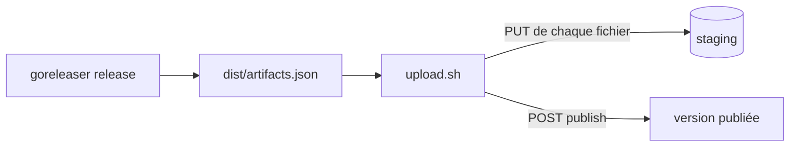

Ce guide publie la sortie de `goreleaser release` comme une version d'un produit. Utilisez-le quand votre projet est déjà construit avec goreleaser : `scripts/upload.sh` lit le `dist/artifacts.json` de goreleaser, il fonctionne donc quelle que soit l'organisation de vos archives.



## Avant de commencer

- Un registre joignable, par exemple `https://registry.example.com`, et son token d'upload. Voir [Configuration](../operations/configuration.md) si vous exploitez le serveur vous-même.
- `bash` 3.2 ou plus récent, `curl` et `jq` sur la machine qui publie.
- `scripts/upload.sh`. Il est fourni dans chaque archive de release de local-registry. Copiez-le dans votre dépôt, par exemple en `ci/upload.sh`, pour que chaque build utilise la même version.
- Une fiche produit `registry.yaml` à la racine de votre projet. Le serveur refuse une version sans elle. Voir [Écrire la fiche produit](write-registry-yaml.md).

> [!IMPORTANT]
> Publiez **après** la fin de `goreleaser release`. goreleaser écrit `dist/artifacts.json` après ses propres `publishers:`, un publisher goreleaser ne peut donc pas l'envoyer.

## Étapes

1. **Construisez la release.** Depuis la racine du projet, sur un tag :

   ```sh
   git tag v1.4.2
   goreleaser release --clean
   ```

   Si goreleaser ne doit pas créer de release GitHub ou GitLab, ajoutez `--skip=publish`. `dist/artifacts.json`, `dist/metadata.json` et `dist/CHANGELOG.md` sont quand même écrits.

2. **Vérifiez ce qui serait envoyé.** Une simulation lit `artifacts.json`, vérifie que chaque fichier existe et qu'une fiche produit est trouvée, et n'envoie rien. Elle ne demande ni URL ni token.

   ```sh
   ci/upload.sh --dry-run sonarbridge dist/artifacts.json
   ```

   ```
   == sonarbridge v1.4.2 from dist/artifacts.json (root /home/me/sonarbridge)
   PUT metadata.json <- /home/me/sonarbridge/dist/metadata.json
   PUT sonarbridge_1.4.2_linux_amd64.tar.gz <- /home/me/sonarbridge/dist/sonarbridge_1.4.2_linux_amd64.tar.gz (sha256 3f1c…)
   …
   PUT registry.yaml <- /home/me/sonarbridge/registry.yaml
   PUT CHANGELOG.md <- /home/me/sonarbridge/dist/CHANGELOG.md
   PUT artifacts.json <- dist/artifacts.json
   POST publish sonarbridge/v1.4.2 (latest=true)
   ```

   La version vient du `tag` de `metadata.json`. Passez `--version` pour en choisir une autre.

3. **Publiez.** Définissez l'adresse du registre et le token, puis lancez le script sans `--dry-run`. Ajoutez `--latest` pour faire de cette version la dernière version du produit.

   ```sh
   export LOCAL_REGISTRY_URL=https://registry.example.com
   export LOCAL_REGISTRY_UPLOAD_TOKEN=…   # depuis votre coffre de secrets, jamais en ligne de commande
   ci/upload.sh --latest sonarbridge dist/artifacts.json
   ```

   Le script envoie le token sur l'entrée standard de curl : il n'apparaît jamais dans la liste des processus. Il se termine par la réponse du serveur :

   ```json
   {"product":"sonarbridge","version":"v1.4.2","files":["CHANGELOG.md","artifacts.goreleaser.json","artifacts.json",…],"latest":true}
   ```

## Vérifier le résultat

```sh
curl -fsS https://registry.example.com/sonarbridge/releases/v1.4.2 | jq '{version, tag, changes, files: [.artifacts[].name]}'
curl -fsS https://registry.example.com/sonarbridge/index | jq '{latest, versions: [.versions[].version]}'
```

`release.json` liste chaque fichier avec sa plateforme, sa taille et son sha256. Si vous avez utilisé `--latest`, le `latest` de l'index vaut maintenant `v1.4.2`.

## Ce que le script envoie

- Chaque fichier que goreleaser marque comme faisant partie de la release : archives, paquets, checksums, signatures, certificats, SBOM, `metadata.json`, et binaires publiés tels quels (`formats: [binary]`). Chaque fichier part avec son sha256 quand `artifacts.json` en donne un, et le serveur le vérifie à la réception.
- Les sorties de build brutes (entrées `Binary` sans format) sont ignorées. Ce sont les fichiers à partir desquels vos archives sont faites.
- `registry.yaml`, puis `dist/CHANGELOG.md` s'il existe, puis `artifacts.json` en dernier, comme l'exige le serveur.

Le script trouve les fichiers grâce aux champs `path` d'`artifacts.json`. Il devine le dossier auquel ils sont relatifs. S'il se trompe, il s'arrête avec `not found (wrong --root?)` : passez `--root` avec le dossier de travail de goreleaser.

Toutes les options sont dans [Scripts](../reference/scripts.md).

## En cas de problème

- **Le script s'arrête avant d'envoyer quoi que ce soit.** Un fichier manque, deux fichiers ont le même nom, ou aucun `registry.yaml` n'a été trouvé. Corrigez la cause et relancez.
- **Le serveur refuse la publication (`422`).** Rien n'est publié et les fichiers envoyés restent en staging. Corrigez la cause et relancez le script : il remplace les fichiers en staging. Voir [Staging et publication](../concepts/staging-and-publish.md).
- **`409 … already published`.** Une version est immuable. Publiez une nouvelle version.
- **`metadata.json describes …, not …`.** La version de l'URL n'est pas le tag goreleaser. Retirez `--version`, ou passez le tag.

Chaque message est expliqué dans [Dépannage](../troubleshooting.md) et [Erreurs](../reference/errors.md).

## L'autre script

`scripts/publish-to-local-registry.sh [--latest] <product> [dist-dir]` est un script `sh` POSIX, sans `jq`. Il ne fonctionne que si chaque fichier du fichier de checksums se trouve à la racine de `dist-dir` sous son nom publié, et il lit `registry.yaml` dans le dossier courant. Préférez `upload.sh` dans tous les autres cas, et sous Windows.

## Et ensuite

- Automatiser : [Publier depuis la CI](ci-pipelines.md).
- Changer la version désignée comme dernière : [Changer la dernière version](change-latest.md).
