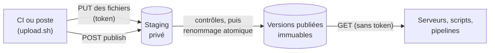

local-registry est un registre de versions privé. Vos équipes y publient leurs livrables versionnés (binaires Go construits par goreleaser, migrations de base de données, paquets de configuration, n'importe quel fichier), et vos machines, scripts et pipelines les y téléchargent.

C'est un binaire statique unique, sans base de données : il range tout dans un simple dossier et le sert en HTTP.

## Pourquoi l'utiliser

La plupart des organisations ont besoin d'un endroit pour leurs versions internes qui ne soit ni une page de release GitHub publique, ni un gestionnaire d'artefacts complet. local-registry comble ce manque avec trois promesses :

| Promesse | Ce que cela vous garantit |
| --- | --- |
| **Une version apparaît entière, ou pas du tout** | Les fichiers sont déposés dans une zone privée (le staging), vérifiés, puis publiés en une seule opération atomique. Un client ne voit jamais une version à moitié livrée. |
| **Ce que vous téléchargez est ce qui a été construit** | Chaque fichier est contrôlé par son sha256 avant publication. Les checksums accompagnent la version. |
| **Une version publiée ne change jamais** | Une fois publiée, une version est immuable. Un nouvel envoi répond `409 Conflict`. |

En plus des fichiers, le serveur écrit une description normalisée de chaque version, `release.json`, et de chaque produit, `index.json`. Les clients lisent ces documents au lieu de deviner des noms de fichiers. C'est le [standard `local-registry/v1`](./concepts/standard-v1.md).

## Fonctionnement

1. Un éditeur dépose les fichiers d'une version, avec un token d'upload.
2. Il demande la publication. Le serveur contrôle les fichiers, écrit `release.json` et rend la version visible en une seule étape.
3. Toute machine du réseau lit le catalogue et télécharge les fichiers. La lecture ne demande aucun token.

Le détail est dans [Staging et publication](./concepts/staging-and-publish.md).

## À qui s'adresse cette documentation

| Vous êtes… | Commencez par |
| --- | --- |
| **Responsable de release ou de CI**, vous publiez des versions | [Démarrage rapide](./getting-started/quick-start.md), puis [Première release goreleaser](./getting-started/first-release-goreleaser.md) ou [Publier des fichiers sans goreleaser](./getting-started/first-release-files.md) |
| **Exploitant de la plateforme**, vous faites tourner le serveur | [Installation](./operations/install.md), [Configuration](./operations/configuration.md), [Sécurité](./operations/security.md) |
| **Intégrateur**, vous consommez les versions | [Consommer les versions](./guides/consume-releases.md) et la [référence de l'API HTTP](./reference/api/index.md) |

## Ce que ce n'est pas

Mieux vaut connaître le périmètre avant de l'adopter :

- **Pas un registre de conteneurs ni de paquets.** Il ne parle ni Docker, ni npm, ni Maven, ni APT. Il sert des fichiers en HTTP simple.
- **Pas de contrôle d'accès en lecture.** Tout ce qui est publié est lisible par quiconque atteint le serveur. Placez-le sur un réseau privé ou derrière un reverse proxy qui authentifie. Voir [Sécurité](./operations/security.md).
- **Pas multi-nœud.** Un serveur possède un dossier de stockage. Voir [Limites](./limitations.md).

> [!TIP]
> Le vocabulaire (produit, version, staging, latest) est nouveau pour vous ? Le [Glossaire](./glossary.md) définit chaque terme en une ligne.
