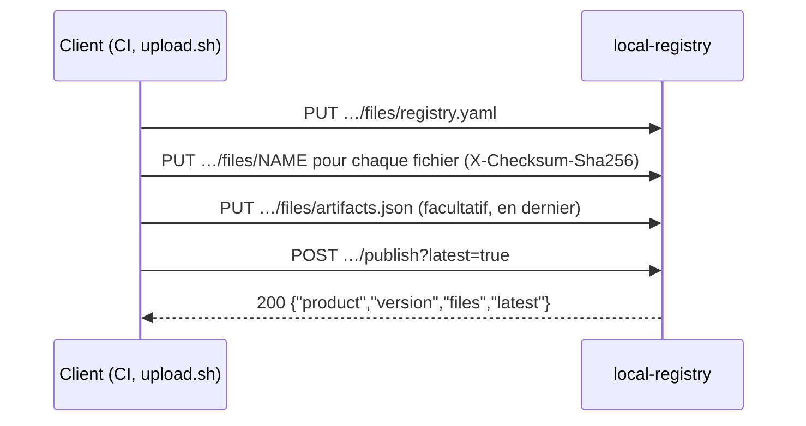

Une version se publie en deux temps : déposer chaque fichier dans la zone de staging de la version, puis la publier. La publication vérifie les fichiers déposés comme un tout et rend la version visible en une seule opération ; d'ici là, rien n'est public. Le principe est expliqué dans [Staging et publication](../../concepts/staging-and-publish.md) ; les scripts qui le font pour vous sont dans [Scripts](../scripts.md).



## Authentification

Les deux routes exigent le jeton de dépôt configuré sur le serveur (`LOCAL_REGISTRY_UPLOAD_TOKEN` ou `upload-token`), envoyé comme jeton bearer. Il est vérifié en temps constant, avant toute autre chose.

```
Authorization: Bearer <token>
```

| Situation | Réponse |
| --- | --- |
| Le serveur n'a aucun jeton configuré | `403 upload is disabled: no token configured` |
| En-tête absent, autre schéma, ou mauvais jeton | `401 invalid or missing bearer token`, avec `WWW-Authenticate: Bearer` |

Chaque tentative est enregistrée dans le [journal d'audit](../../operations/audit-log.md), refus compris ; le jeton lui-même ne l'est jamais, seulement son `token_id`.

Envoyez l'en-tête sur l'entrée standard de curl, pour que le jeton n'apparaisse pas dans la liste des processus :

```sh
auth() { printf 'Authorization: Bearer %s\n' "$LOCAL_REGISTRY_UPLOAD_TOKEN"; }
auth | curl -fsS -H @- …
```

## Déposer un fichier

`PUT /{product}/artifacts/{version}/files/{name}`

Envoie un fichier en flux dans la zone de staging de `<product>/<version>`. Rien n'est visible avant la publication.

| Paramètre | Où | Description |
| --- | --- | --- |
| `product` | chemin | Nom du produit. `products` est réservé. |
| `version` | chemin | Nom de version. `latest`, `artifacts.json`, `artifacts.goreleaser.json`, `release.json` et `index.json` sont refusés. |
| `name` | chemin | Nom du fichier publié. `artifacts.goreleaser.json`, `release.json` et `index.json` sont réservés : le serveur les écrit. |
| `Authorization` | en-tête | `Bearer <token>`. |
| `X-Checksum-Sha256` | en-tête, facultatif | sha256 attendu du corps, en hexadécimal, casse indifférente. Une différence refuse le fichier (`422`) et ne garde rien. |
| corps | — | Contenu brut du fichier (`curl -T fichier`). Pas de multipart : `curl -F` stockerait l'enveloppe multipart. |

```sh
f=billing-db-migrations_1.0.0.tar.gz
auth | curl -fsS -H @- -H "X-Checksum-Sha256: $(shasum -a 256 "$f" | cut -d' ' -f1)" \
  -T "$f" "https://registry.example.com/billing-db-migrations/artifacts/v1.0.0/files/$f"
```

`201 Created` :

```json
{"name": "billing-db-migrations_1.0.0.tar.gz", "size": 2311, "sha256": "6c08926d953d80ba627847e1b3eaa893e6040e239a197083f83cda85341baa00"}
```

| Champ | Contenu |
| --- | --- |
| `name` | Nom du fichier en staging. |
| `size` | Octets reçus. |
| `sha256` | sha256 des octets reçus, en hexadécimal. |

Comportement :

- Le corps est écrit en flux dans `bin.local/.uploads-tmp/`, puis déplacé en staging une fois complet et vérifié. Un dépôt interrompu ou refusé ne laisse rien.
- Déposer à nouveau le même nom remplace le fichier en staging.
- `registry.yaml` est validé à réception (voir [registry.yaml](../registry-yaml.md)) ; `CHANGELOG.md` doit être du texte UTF-8 d'au plus 1 Mio.
- **`artifacts.json`, si vous en envoyez un, doit être déposé en dernier.** À réception, chaque fichier qu'il publie doit déjà être en staging, avec le sha256 de son `extra.Checksum`. Le déposer à nouveau le revérifie.
- La requête peut durer jusqu'à 30 minutes.

Erreurs, dans l'ordre où elles sont vérifiées :

| Statut | Message |
| --- | --- |
| `403`, `401` | Voir [Authentification](#authentification). |
| `400` | `invalid product or version name` |
| `400` | `product name products is reserved` |
| `400` | `version name <version> is reserved` |
| `400` | `invalid file name: use [A-Za-z0-9._-] only` |
| `400` | `<name> is reserved: publishing writes it` |
| `409` | `version <product>/<version> is already published and cannot be changed` |
| `422` | `version <product>/<version> already has <n> staged files (limit <n>)` (remplacer un fichier en staging reste permis) |
| `413` | `file exceeds <bytes> bytes` |
| `413` | `version <product>/<version> would exceed its staging quota of <bytes> bytes` |
| `507` | `upload staging area is full (limit <bytes> bytes): publish or abandon pending versions` |
| `507` | `not enough free disk space on the registry` |
| `422` | `sha256 mismatch: got <actual>, X-Checksum-Sha256 says <expected>` |
| `422` | `registry.yaml: <reason>`, `registry.yaml is larger than 64 KiB` |
| `422` | `CHANGELOG.md is larger than 1 MiB`, `CHANGELOG.md is not UTF-8 text` |
| `422` | `artifacts.json …` : voir [Règles de dépôt](../upload-rules.md) |
| `500` | `internal error` (erreur disque, client déconnecté) |

Les quotas sont décrits dans [Quotas et staging](../../operations/quotas-and-staging.md) ; chaque message, avec sa cause et sa correction, est dans [Erreurs](../errors.md).

## Publier une version

`POST /{product}/artifacts/{version}/publish`

Vérifie les fichiers en staging de `<product>/<version>`, écrit les documents de la version, puis rend la version visible en un seul renommage. Pas de corps de requête.

| Paramètre | Où | Description |
| --- | --- | --- |
| `product`, `version` | chemin | Comme pour le dépôt. |
| `latest` | requête, facultatif | `true` : fait aussi de cette version la dernière du produit. Accepte `true`/`false`, `1`/`0`, `t`/`f`, casse indifférente. Par défaut `false`. |
| `Authorization` | en-tête | `Bearer <token>`. |

```sh
auth | curl -fsS -H @- -X POST "https://registry.example.com/billing-db-migrations/artifacts/v1.0.0/publish?latest=true"
```

`200 OK` :

```json
{
  "product": "billing-db-migrations",
  "version": "v1.0.0",
  "files": ["CHANGELOG.md", "billing-db-migrations_1.0.0.tar.gz", "checksums.txt", "registry.yaml", "release.json"],
  "latest": true
}
```

| Champ | Contenu |
| --- | --- |
| `product`, `version` | La version publiée. |
| `files` | Tous les fichiers de la version publiée, triés, y compris ceux que le serveur a écrits (`release.json`, `artifacts.goreleaser.json`, un `checksums.txt` généré). |
| `latest` | Si la version est devenue la dernière. |

Ce qui est vérifié, puis ce qui se passe, étape par étape, est décrit dans [Règles de dépôt](../upload-rules.md). En bref : `registry.yaml` est obligatoire ; `artifacts.json`, `metadata.json` et le fichier de checksums sont facultatifs mais vérifiés s'ils sont présents ; il faut au moins un artefact. Quand une vérification échoue, rien n'est publié et le staging est conservé : corrigez le fichier, déposez-le à nouveau et rappelez la publication.

Erreurs :

| Statut | Message |
| --- | --- |
| `403`, `401` | Voir [Authentification](#authentification). |
| `400` | `invalid product or version name`, `product name products is reserved`, `version name <version> is reserved` |
| `400` | `latest must be true or false` |
| `409` | `version <product>/<version> is already published and cannot be changed` |
| `404` | `nothing uploaded for <product>/<version>` |
| `422` | `several checksums files: <a> and <b>` |
| `422` | `registry.yaml not uploaded: every version needs its product card` |
| `422` | `<checksums>: line <n> is not "<sha256>  <name>"` |
| `422` | `<name> is not listed in <checksums>` |
| `422` | `<name>: sha256 is <actual> but <checksums> says <expected>` |
| `422` | `metadata.json is not valid JSON`, `metadata.json has neither tag nor version` |
| `422` | `metadata.json describes <tag> (version <version>), not <version>` |
| `422` | `artifacts.json …` : voir [Règles de dépôt](../upload-rules.md) |
| `422` | `<name> is uploaded but artifacts.json does not list it` |
| `422` | `no artifact to publish: upload at least one file besides registry.yaml` |
| `500` | `internal error`. Quand il survient après le renommage, la version **est** publiée ; le journal du serveur indique `version published but latest not updated` ou `version published but index.json not updated`. |

> [!WARNING]
> Une version publiée est immuable : tout `PUT` ou `publish` ultérieur pour elle répond `409`. Pour livrer un correctif, publiez une nouvelle version.
