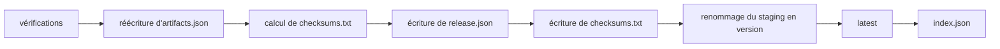

Cette page est le contrat exact de `POST /{product}/artifacts/{version}/publish` : les vérifications qu'elle applique aux fichiers en staging, dans l'ordre, puis les étapes qu'elle exécute. Si une vérification échoue, rien n'est publié et le staging reste tel quel : corrigez la cause, déposez le fichier corrigé sous le même nom, et publiez à nouveau. Pour la requête elle-même, voir [API de dépôt](./api/upload.md).

## Fichiers d'une version

| Fichier | Obligatoire | Écrit par | Remarques |
| --- | --- | --- | --- |
| `registry.yaml` | **oui** | l'équipe | La fiche produit. Voir [registry.yaml](./registry-yaml.md). |
| au moins un artefact | **oui** | le build | Archive, binaire, paquet ou tout autre fichier. |
| `CHANGELOG.md` | non | goreleaser ou l'équipe | Notes de version. Voir [CHANGELOG.md](./changelog-format.md). |
| `*checksums.txt` | non | goreleaser | Un seul au plus. Sans lui, la publication écrit `checksums.txt`. |
| `metadata.json` | non | goreleaser | Fournit `tag`, `commit`, `builtAt`… |
| `artifacts.json` | non | goreleaser, ou à la main | Fournit le type et la plateforme de chaque fichier. Déposé en dernier. |
| signatures, certificats, SBOM | non | le build | Rattachés au fichier qu'ils couvrent. |
| `release.json`, `artifacts.goreleaser.json`, `index.json` | — | **le serveur** | Réservés : les déposer répond `400`. |

## Vérifications

Elles s'exécutent dans cet ordre ; le premier échec répond.

| # | Vérification | Échec |
| --- | --- | --- |
| 1 | `{product}` et `{version}` sont des noms valides, non réservés ; `latest` est un booléen. | `400` |
| 2 | La version n'est pas déjà publiée. | `409 version <product>/<version> is already published and cannot be changed` |
| 3 | Quelque chose est en staging pour la version. | `404 nothing uploaded for <product>/<version>` |
| 4 | Au plus un fichier de checksums (nom finissant par `checksums.txt`, casse ignorée). | `422 several checksums files: <a> and <b>` |
| 5 | `registry.yaml` est en staging. | `422 registry.yaml not uploaded: every version needs its product card` |
| 6 | Avec un fichier de checksums : chaque ligne vaut `<sha256 en 64 hex>  <name>` (`*name` accepté ; lignes vides ignorées). | `422 <checksums>: line <n> is not "<sha256>  <name>"` |
| 7 | Avec un fichier de checksums : chaque fichier en staging y figure avec un sha256 identique, sauf le fichier de checksums lui-même, `registry.yaml`, `CHANGELOG.md`, `metadata.json`, les fichiers écrits par le serveur, et `*.sig`, `*.pem`, `*.sigstore.json`. Des lignes nommant des fichiers non déposés sont permises. | `422 <name> is not listed in <checksums>`, `422 <name>: sha256 is <actual> but <checksums> says <expected>` |
| 8 | Avec `metadata.json` : c'est un objet JSON avec `tag` ou `version`, et `{version}` vaut `tag`, `version`, ou `v` + `version`. | `422 metadata.json is not valid JSON`, `422 metadata.json has neither tag nor version`, `422 metadata.json describes <tag> (version <v>), not <version>` |
| 9 | Avec `artifacts.json` : il repasse les [contrôles d'artifacts.json](#contrôles-dartifactsjson), ce qui détecte un fichier retiré ou remplacé après son dépôt. | `422 artifacts.json …` |
| 10 | Avec `artifacts.json` : chaque fichier en staging est l'une de ses entrées publiées, sauf `registry.yaml`, `CHANGELOG.md` et `metadata.json`. | `422 <name> is uploaded but artifacts.json does not list it` |
| 11 | Au moins un artefact : un fichier autonome, pas seulement `registry.yaml`, `CHANGELOG.md`, `metadata.json`, des checksums ou des pièces jointes. | `422 no artifact to publish: upload at least one file besides registry.yaml` |
| 12 | `registry.yaml` et `metadata.json` peuvent être lus pour `release.json`. | `422 registry.yaml: <reason>`, `422 metadata.json is not valid JSON` |

## Étapes après les vérifications

Les étapes 1 et 2 s'exécutent dès que les vérifications 9 et 10 sont passées, avant les vérifications 11 et 12. Elles ne touchent que le staging : si une vérification ultérieure échoue, la publication suivante repart de l'`artifacts.json` déposé, conservé sous le nom `artifacts.goreleaser.json`.



1. **artifacts.json** (s'il a été déposé) : le fichier déposé est conservé sous `artifacts.goreleaser.json` et remplacé par sa [réécriture](#réécriture-dartifactsjson).
2. **checksums.txt** (si aucun fichier de checksums n'a été déposé) : calculé à partir des fichiers en staging, au format goreleaser : une ligne `<sha256>  <name>` par fichier qui en a besoin (les mêmes que pour la vérification 7), triées par nom.
3. **release.json** est écrit dans le staging. Voir [release.json](./release-json.md).
4. Le `checksums.txt` calculé est écrit dans le staging.
5. **Renommage.** Le répertoire de staging `bin.local/.uploads/<product>/<version>/` est renommé en `bin.local/assets/binaries/<product>/<version>/` : la version apparaît complète, en une opération.
6. **Latest** (avec `latest=true`) : l'`artifacts.json` de la version est copié dans `<product>/artifacts.json`, ou cette copie est supprimée quand la version n'en a pas ; puis son `release.json` est copié dans `<product>/release.json`, écrit en dernier parce que c'est la marque qui désigne la dernière version. Chaque copie est atomique (fichier temporaire, puis renommage). Voir [Dernière version](../concepts/latest.md).
7. **index.json** : `<product>/index.json` est réécrit de façon atomique. Voir [index.json](./index-json.md).

Un échec à l'étape 6 ou 7 répond `500 internal error`, mais la version **est** publiée : le journal du serveur indique `version published but latest not updated` ou `version published but index.json not updated`. Corrigez la cause (disque, droits) et réglez latest à la main si besoin (voir [Changer la dernière version](../guides/change-latest.md)) ; l'index est reconstruit par la publication suivante, et `GET /{product}/index` n'en dépend jamais.

## Contrôles d'artifacts.json

Ils s'exécutent au dépôt d'`artifacts.json`, puis de nouveau à la publication (vérification 9).

Une entrée est un **fichier publié** quand son `type` vaut `Archive`, `File`, `Source`, `Linux Package`, `Checksum`, `Signature`, `Certificate`, `SBOM` ou `Metadata`, ou `Binary` **avec** `extra.Format` (goreleaser `formats: [binary]`). Les autres entrées sont ignorées, notamment `Binary` sans `extra.Format` : la sortie de build brute dont une archive est faite, jamais dans le fichier de checksums, souvent plusieurs fois sous le même nom.

| Règle | Message `422` |
| --- | --- |
| Un tableau JSON d'objets, 32 Mio au plus | `artifacts.json is not a JSON array of objects`, `artifacts.json: entry <i> is null`, `artifacts.json is larger than 32 MiB` |
| `name`, `path` et `type` sont des chaînes | `artifacts.json: name, path and type must be strings: <reason>` |
| Chaque fichier publié a un nom | `artifacts.json: a <type> entry has no name` |
| Aucun nom publié n'apparaît deux fois | `artifacts.json lists <name> twice` |
| Chaque nom est valide et non réservé (`artifacts.json`, `artifacts.goreleaser.json`, `release.json`, `index.json`) | `artifacts.json lists "<name>", a name that cannot be uploaded` |
| Chaque fichier publié est en staging | `artifacts.json references <name>, which is not uploaded: upload every file first, artifacts.json last` |
| Son sha256 correspond à `extra.Checksum` quand celui-ci commence par `sha256:` | `<name>: sha256 is <actual> but artifacts.json says <expected>` |

## Réécriture d'artifacts.json

L'`artifacts.json` publié ne garde que les entrées publiées, dans leur ordre d'origine. Dans chaque entrée, seul `path` change : il devient l'URL de téléchargement du fichier, `/{product}/artifacts/{version}/files/{name}`, sous `--public-url` s'il est défini. Les autres champs sont conservés tels que déposés ; les clés sont triées par ordre alphabétique et indentées de 2 espaces.

Entrée déposée :

```json
{"name": "sonarbridge_1.4.2_linux_amd64.tar.gz", "path": "dist/sonarbridge_1.4.2_linux_amd64.tar.gz",
 "goos": "linux", "goarch": "amd64", "goamd64": "v1", "internal_type": 1, "type": "Archive",
 "extra": {"Checksum": "sha256:3f1c…", "Format": "tar.gz", "ID": "sonarbridge"}}
```

Entrée publiée, avec `--public-url https://registry.example.com` :

```json
{"extra": {"Checksum": "sha256:3f1c…", "Format": "tar.gz", "ID": "sonarbridge"},
 "goamd64": "v1", "goarch": "amd64", "goos": "linux", "internal_type": 1, "name": "sonarbridge_1.4.2_linux_amd64.tar.gz",
 "path": "https://registry.example.com/sonarbridge/artifacts/v1.4.2/files/sonarbridge_1.4.2_linux_amd64.tar.gz", "type": "Archive"}
```

## Garanties

| Garantie | Mécanisme |
| --- | --- |
| Un fichier en cours de réception n'est jamais visible | Il est reçu dans `bin.local/.uploads-tmp/`, puis déplacé en staging une fois complet et vérifié. |
| Une version apparaît complète ou pas du tout | La publication renomme le répertoire de staging en une seule opération. |
| Les fichiers publiés correspondent à leurs checksums | Chaque fichier est vérifié contre le fichier de checksums déposé ; sans lui, la publication l'écrit à partir des fichiers en staging. |
| Les chemins d'`artifacts.json` pointent vers les fichiers de la version | Réécrits dans le staging, avant le renommage, après vérification de chaque fichier listé. |
| Latest change en une étape | `<product>/release.json` est remplacé de façon atomique, après `<product>/artifacts.json`. |
| Une version publiée ne change jamais | `PUT` et la publication répondent `409`. |
| Des dépôts parallèles ne peuvent pas dépasser un quota ensemble | Les quotas sont revérifiés sous le verrou de dépôt. |

> [!IMPORTANT]
> Les renommages ne sont atomiques que parce que `bin.local/.uploads-tmp`, `bin.local/.uploads` et `bin.local/assets` sont sur le même système de fichiers : ne les montez pas séparément. Le verrou de dépôt est tenu par un seul processus : ne faites tourner qu'un serveur acceptant les dépôts par répertoire de données.
